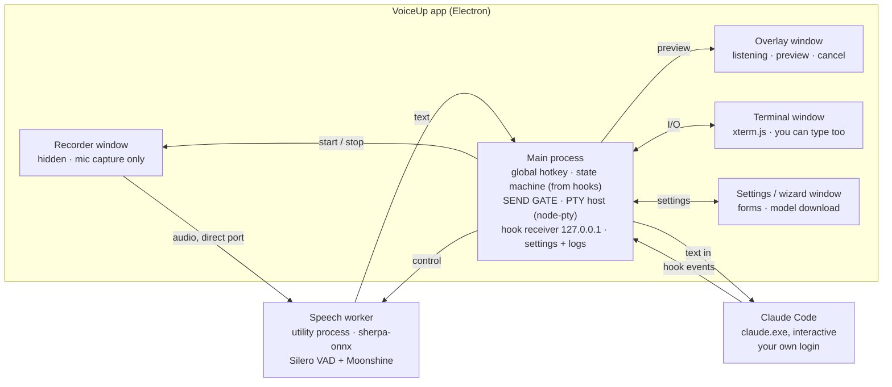
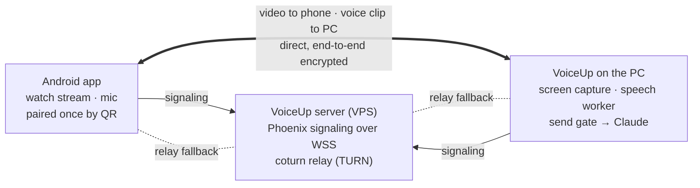

# VoiceUp — Project Plan

Last updated: 2026-11-02 · Owner: Antonio

## How to use this plan with Claude Code

Build one story per Claude Code session, in milestone order, and never let Claude start the next story until the current one meets the Definition of Done.

1. Commit this file to the repo as `docs/PLAN.md`.
2. `CLAUDE.md` at the repo root holds the stack, the commands (`npm run dev`, `npm test`, `npm run lint`, `npm run typecheck`) and the Engineering practices section below. Claude Code reads it automatically at session start; keep it under ~150 lines so it stays useful.
3. Start each session with: *"Read docs/PLAN.md. Implement story S2.3 only. Plan first, then implement, then show me the test results."* Use plan mode for anything marked **Spike** or touching more than ~5 files.
4. Review the diff yourself. **Practice:** one story = one branch = one squashed commit with a message like `feat(S2.3): hook state machine`. Small commits make it trivial to revert a bad Claude change. After your review, Claude squash-merges the branch to local `main` and pushes only when you ask. From S0.3 on, the branch must be pushed and CI green before that merge.
5. Tick the `[ ]` in the story's title here when merged. If Claude discovers something the plan got wrong, fix the plan first, then the code. The plan is the source of truth.

**Story IDs** follow `S<epic>.<n>`. Stories marked **Spike** are time-boxed experiments: their output is a written finding (a short note in `docs/decisions/`), not production code.

## Product summary

VoiceUp is a Windows desktop app that hosts a Claude Code session in its own terminal and lets you speak commands to it with one hotkey from any app; speech is transcribed locally and sent only when Claude is ready. Version 1.2 adds an Android companion app for watching the desktop and speaking commands from anywhere.

**Users:** you and a few friends, each on their own PC (and, from v1.2, their own phone) with their own Claude Pro/Max login.

**Desktop loop (v1.0):** press hotkey (any app focused) → speak → ~1.2 s of silence ends recording → local speech model transcribes → 1 s preview with cancel → text is typed into the Claude Code session, but only when Claude is ready for it.

**Claude in Chrome (v1.0):** onboarding guides the extension install and VoiceUp launches Claude with `--chrome`, so Claude can operate the browser.

**Phone loop (v1.2):** open the VoiceUp Android app → it connects to your paired PC through the VoiceUp server, like AnyDesk → you watch a live, view-only video of the desktop (for example Claude driving Chrome) → tap the mic and speak → the clip goes to the PC, where the same local transcription, preview and send gate handle it.

### Goals (v1.0)

- One-key voice input on the PC that works while another app is focused.
- Fully local speech-to-text; audio never goes to any third party.
- Never types into a Claude permission prompt, and blocks voice whenever hooks cannot show that Claude's main prompt is ready. Hooks do not report every local menu, so S2.1 tests them and unconfirmed states fail closed.
- One `.exe` installer; first run gets a non-technical friend from zero to a working session, including Claude Code, browser login and Claude in Chrome.
- Uses each user's normal subscription through the official `claude` binary in interactive mode. No `claude -p`, no API key, no token handling.

### Goals (v1.2)

- Phone: view-only desktop stream and voice commands from anywhere, with no port forwarding or extra software on the PC.
- Transcription stays on the PC; the phone sends a voice clip, which passes through the same send gate as local voice.
- The phone can never move the PC's mouse or type on its keyboard. Phone voice can still drive Claude, so a stolen paired phone is remote command execution limited by Claude's permission mode; S9.1 must treat it that way.

### Non-goals

- Remote mouse or keyboard control of the PC, in any version (excluded by design, not postponed).
- Phone features in v1.0.
- iOS app; macOS or Linux desktop.
- Languages other than English.
- Answering permission prompts by voice.
- Transcription on the phone, or streaming PC audio to the phone.
- Text-to-speech of Claude's replies.
- Multiple simultaneous Claude sessions or tabs.
- Marketing or selling. The repo and Releases are public, but each user installs the app and signs in with their own Claude account (see Risks: policy).

## Architecture and stack

One Electron app owns four windows (terminal, overlay, recorder, settings/wizard) and two local child processes; the main process is the only place that decides whether text may be typed into Claude.

Audio frames go from the hidden recorder to the speech worker, which detects the end of speech and returns text; Claude Code reports its state to the main process through official hooks, and the send gate uses that state to allow, queue or block typing.

| Layer | Choice | Why |
| --- | --- | --- |
| App shell | Electron + TypeScript, scaffolded with `electron-vite` | Mature desktop runtime; same terminal stack as VS Code |
| Terminal | `node-pty` (Windows ConPTY) + `@xterm/xterm` with fit, webgl and unicode11 addons | Renders Claude Code's full TUI correctly |
| Global hotkey | Electron `globalShortcut` | Fires while another app has focus |
| End-of-speech detection | Silero VAD inside the same sherpa-onnx worker; mic captured with `getUserMedia` + AudioWorklet in a hidden window | Real-time endpointing in the same engine; no WASM runtime to bundle |
| Transcription | `sherpa-onnx-node` in an Electron utility process; Moonshine base by default (S4.1), Parakeet TDT 0.6B v2 (int8) as an option | One native addon for VAD and speech-to-text; top local English accuracy; no extra server process or port |
| Claude state | Claude Code `http` hooks to a local receiver | Official and documented; no screen scraping |
| Validation | zod | One schema per boundary |
| Tests | Vitest | Fast unit tests for `src/core` |
| Packaging | `electron-builder` (NSIS, per-user) | Single `.exe`, no admin rights |
| Logging | electron-log | Rotating files, levels |

**Why sherpa-onnx instead of whisper.cpp:** one prebuilt native addon does both end-of-speech detection (Silero VAD) and recognition, so there is no separate server process, no localhost port and no WASM runtime in the renderer. It also runs models built for short live speech: Parakeet TDT 0.6B v2 leads local English accuracy on the Open ASR Leaderboard (about 6.05% average WER vs 7.44% for Whisper large-v3) and is fast on CPU, while Moonshine processes only the audio it gets instead of Whisper's fixed 30-second window, which cuts latency on short commands. whisper.cpp stays the documented fallback if S4.1 finds a blocker.

### Remote connection (v1.2)

The phone and the PC talk directly over an encrypted WebRTC connection; your server only introduces them and, when carrier networks block a direct path, forwards packets it cannot read.

This is the AnyDesk model: both devices make outbound connections to your server, so no ports are opened on the PC and nothing extra is installed there.

| Piece | Choice | Why |
| --- | --- | --- |
| Signaling | Elixir + Phoenix 1.8 Channels over WSS on a small EU VPS | Your strongest stack, and Channels fit this exactly |
| Relay | coturn or eturnal (decided in S8.1) on the same VPS, short-lived credentials | Mobile carriers' NAT often blocks direct connections |
| TLS | Caddy with Let's Encrypt on your own domain | Automatic certificates |
| PC video | Electron `desktopCapturer` + `getDisplayMedia`, `RTCPeerConnection` in a hidden window | Built into Electron; Chromium handles encoding and congestion control |
| Android app | Kotlin + Jetpack Compose, `io.getstream:stream-webrtc-android` | Maintained WebRTC build for Android |
| Phone voice | Clip recorded on the phone, sent over the encrypted data channel | Reuses the PC's speech worker, preview and send gate unchanged |
| Repo | Monorepo: `desktop/`, `android/`, `server/`, `protocol/` | One place for the shared message schema |

## Engineering practices and Definition of Done

These rules go into `CLAUDE.md` verbatim; they are what keeps AI-written code maintainable.

### Code

- **TypeScript strict mode** everywhere (`"strict": true`, no `any` without a comment explaining why).
- **Pure core, thin shell.** Logic that can be tested without Electron (state machine, send gate, text filter, settings validation) lives in `src/core/` with no Electron or Node I/O imports. Electron glue lives in `src/main/`, UI in `src/renderer/`.
- **Validate every boundary** with a schema (zod): settings file, IPC payloads, hook HTTP bodies, model manifest. Reject and log, never trust.
- **No silent catches.** Every caught error is logged with context and either recovered or surfaced to the user.
- **One responsibility per module**; files over ~300 lines are a smell worth splitting.

### Electron security baseline (non-negotiable)

- `contextIsolation: true`, `sandbox: true`, `nodeIntegration: false` on every window.
- Renderers get a minimal API via `contextBridge`; never expose raw `ipcRenderer`.
- Validate the sender of every IPC message in the main process.
- Strict Content-Security-Policy (`default-src 'self'`); load only bundled local files, never remote content.
- Block navigation and new-window creation.
- Flip unneeded Electron fuses (e.g. `RunAsNode`) at package time.
- Local servers bind to `127.0.0.1` only, on a random port, and require a per-launch random token.

### Remote access security baseline (v1.2, non-negotiable)

Streaming a desktop to a phone is the most dangerous thing this project does; these rules apply to every v1.2 story.

- **Threat model before code.** S9.1 is written and reviewed before any streaming code exists.
- **View-only by construction.** The PC contains no code path that injects mouse or keyboard input from the phone. The data channel accepts exactly two phone→PC message types (voice clip, cancel), each schema-validated; anything else closes the connection. A voice clip still becomes a Claude command after the send gate, so the threat model treats phone voice as command execution, not as viewing.
- **The server is untrusted.** Peers sign their WebRTC DTLS fingerprints with their paired device keys and verify each other's, so even a compromised server cannot man-in-the-middle the stream.
- **Keys stay in the OS vault.** PC private key in Electron `safeStorage` (Windows DPAPI); phone private key in Android Keystore. Never in plain files, never in logs.
- **Consent and visibility.** Every session starts explicitly; the PC shows a persistent "Phone is watching" indicator with one-click stop; sessions auto-stop after inactivity (default 15 min).
- **Short-lived relay credentials** (TURN REST API, HMAC, ≤ 10 min), issued only to authenticated paired devices.
- **Server stores no content.** No video, audio or transcripts; only device public keys and connection metadata, with 7-day log retention.
- **Monorepo, shared protocol.** `desktop/`, `android/`, `server/`, `protocol/` in one repo; message schemas live in `protocol/` and both apps are generated or tested against them. Each folder gets its own short `CLAUDE.md`.

### Privacy

- Audio is processed in memory and discarded. Transcripts are not written to disk, except in logs when the user sets the log level to `debug`.
- Logs never contain transcripts at default log level, and never contain anything from `~/.claude/`.
- The app never reads, copies or transmits Claude credentials. Login happens only inside Claude Code's own flow.

### Testing

- **Unit tests (Vitest)** for everything in `src/core/`. The state machine and send gate need near-complete branch coverage: they are the safety-critical parts.
- **Fakes over mocks:** a fake Claude process that emits scripted hook events lets you test delivery logic without a real subscription.
- **Manual test checklist** (`docs/manual-tests.md`) for hardware paths (mic, hotkey, installer) that automation cannot reach; run it before every friend release.

### Dependency hygiene

- **Exact versions and a committed lockfile.** No `^` ranges for Electron, native addons or speech models.
- **Baseline at project start (October 2026):** Electron 45.x (current stable; Electron supports the latest three majors), electron-vite 5 with Vite 7, TypeScript 6, zod 4, Vitest 5, ESLint flat config, scoped `@xterm/*` packages, `node-pty`, `sherpa-onnx-node`. When S0.1 runs, confirm each with `npm view <pkg>@<line> version`: the latest release in the named line, not the latest overall. Checked 2026-11-02: Electron 45.2.1, electron-vite 5.0.0, Vite 7.3.7, TypeScript 6.0.3, Vitest 5.0.5 (moved up from 4 on 2026-11-02), electron-builder 26.18.1, sherpa-onnx-node 2.0.0 (2.0.1 exists but is not verified), ESLint 10.14.0, typescript-eslint 8.72.1, Prettier 3.9.10. TypeScript 7 is not usable yet: typescript-eslint 8.72.1 requires `<6.1.0`. `@types/node` stays on the line of the Node version CI runs (24), so code can't compile against APIs that aren't there at runtime. S0.6 picked `node-pty` 1.2.0-beta.18, from prebuilds with no rebuild (`docs/decisions/S0.6-node-pty-packaging.md`).
- **Upgrade cadence:** Dependabot or Renovate weekly for patches; Electron major upgrades within 8 weeks of release so the app never leaves the supported window.
- **Native modules** (`node-pty`, `sherpa-onnx-node`) are verified in a packaged build for every Electron major before the upgrade merges.
- **CI gates:** `npm audit --omit=dev` fails on high severity; a license check allows only MIT, Apache-2.0, BSD and ISC.
- **Nothing loads from a CDN at runtime.** Every asset is bundled or downloaded with a checksum.

### Definition of Done (every story)

This list is canonical; `CLAUDE.md` and the `story` skill copy it.

- [ ] All acceptance criteria met and demonstrated (test name, command output or manual step per AC).
- [ ] `npm run typecheck`, `npm run lint` and `npm test` pass (from S0.2 on); CI is green on the pushed branch before merge (from S0.3 on).
- [ ] New core logic has unit tests; bugs fixed get a regression test first.
- [ ] No new Electron security warnings; baseline above still holds.
- [ ] User-visible errors have a clear message and a next step (error codes in TECH_SPEC §6.5).
- [ ] `docs/PLAN.md` / `docs/TECH_SPEC.md` updated if scope or design changed; a decision note added for any spike; the story's `[ ]` ticked in PLAN.md at merge.

## Milestones

Nine milestones, built strictly in order. M3 is the first build worth using, M5 is v1.0, and the phone companion (v1.2) starts only after v1.0 is with friends.

| # | Milestone | Epics | Done when |
| --- | --- | --- | --- |
| M0 | Foundation | E0 | An empty, hardened app packages to an `.exe` in CI; `node-pty` proven |
| M1 | Terminal host | E1 | You can use Claude Code inside the app exactly as in Windows Terminal |
| M2 | Speech pipeline | E3, E4 | Hotkey from any app shows your transcript in the overlay (nothing sent yet) |
| M3 | **Claude-aware delivery: first usable build** | E2, E5 | Voice commands reach Claude and never land in a permission prompt |
| — | **Gate** | — | Daily-drive it yourself for one week |
| M4 | Installer, onboarding, Claude in Chrome | E6 | A clean Windows VM goes from `.exe` to a working voice session with Chrome |
| M5 | **Hardening and friends release: v1.0** | E7 | Two friends finish setup without your help |
| — | *v1.2 starts after v1.0 ships* | | |
| M6 | Connection backbone | E8, E9; S11.1, S11.2 | A paired phone on mobile data and the PC exchange authenticated messages |
| M7 | Remote view | E10; S12.1; S11.3, S11.6, S11.7 | The phone on mobile data watches the desktop live, view-only |
| — | **Gate** | — | Security review against the threat model |
| M8 | **Remote voice: v1.2** | E12 except S12.1; S11.4, S11.5 | A command spoken on the phone runs in Claude through the send gate |

Each milestone ends with a working, committed app. E2 is built inside M3 because its spike needs a running terminal (M1). M2 runs in this order, because the recorder streams to the worker: S4.1 → S4.2 → S3.1–S3.6 → S4.3–S4.5. In v1.2, E11 is split: S11.1 and S11.2 belong to M6, because M6 needs a paired phone; S11.3, S11.6 and S11.7 belong to M7; S11.4 and S11.5 belong to M8. S9.1 runs first in M6, because S8.2 needs its key algorithm, and S12.1 runs before S11.7, whose version check needs the protocol.

## Epics and stories

Thirteen epics, 73 stories. E0–E7 make up v1.0 (desktop and Claude in Chrome); E8–E12 make up v1.2 (phone companion) and start only after v1.0 ships. Each story lists its acceptance criteria (AC) and is sized to fit one Claude Code session.

### E0 — Foundation

*Goal: an empty but correctly configured app that builds, tests and packages on Windows.*

**[x] S0.1 Scaffold the project.** As the developer, I want an Electron + TypeScript project so every later story has a home.

- AC: `electron-vite` (structure of the vanilla TS template, hand-adapted because the current template targets other versions and disables the sandbox) in `desktop/` with main, preload and renderer entries; `npm run dev` opens a blank window.
- AC: folder layout under `desktop/`: `src/core`, `src/shared`, `src/main`, `src/preload`, `src/renderer`, `src/worker`, `resources/`, `test/` (TECH_SPEC §2).
- AC: short `desktop/CLAUDE.md` created; versions pinned exactly per the dependency baseline.

**[x] S0.2 Quality tooling.** As the developer, I want lint, format, typecheck and tests wired up from day one.

- AC: ESLint (typescript-eslint, strict), Prettier, Vitest; scripts `lint`, `format`, `typecheck`, `test`.
- AC: one sample core test passes.
- AC: ESLint `no-restricted-imports` enforces the module import rules in TECH_SPEC §2.

**[x] S0.3 CI.** As the developer, I want every push checked on a real Windows runner.

- AC: GitHub Actions on `windows-latest`, per TECH_SPEC §7.3: the `check` job (install, typecheck, lint, test, audit, license check) on every push and PR; the `package` job (unsigned) on `main`, tags and manual dispatch.
- AC: `npm audit --omit=dev --audit-level=high` and the license check fail the build; Renovate or Dependabot is configured.
- AC: `--smoke-test` (TECH_SPEC §7.2) runs on every packaged build. At this point it only proves the app starts and exits 0; S1.1 adds `node-pty` and S4.2 adds speech.
- AC: the packaged `.exe` is uploaded as a build artifact.
- AC: fuses are set with the `electronFuses` key in `electron-builder.yml` (built into electron-builder 26, applied before signing); CI reads them back with `npx @electron/fuses read` and fails if any differs.

**[x] S0.4 Security baseline.** As a user, I want the app hardened before it touches my files and mic.

- AC: every Electron security baseline rule from the practices section is implemented and has a comment pointing to it.
- AC: a test asserts `BrowserWindow` options (`contextIsolation`, `sandbox`, `nodeIntegration`) for every window factory.
- AC: single-instance lock and the startup and shutdown order from TECH_SPEC §3 are in place.
- AC: dev-mode exceptions follow TECH_SPEC §7.1, apply only when `!app.isPackaged`, and a test proves packaged mode accepts `app://` only.

**[x] S0.5 Settings and logging.** As a user, I want my choices remembered; as the developer, I want useful logs.

- AC: settings JSON in `app.getPath('userData')`, validated by a zod schema, with defaults and safe migration of unknown/old fields.
- AC: rotating log file (e.g. electron-log), levels `error`/`warn`/`info`/`debug`; transcripts only at `debug`.
- AC: "Open logs folder" menu item.

**[x] S0.6 Native module spike (Spike, ≤ 2 h).** As the developer, I want proof that `node-pty` builds and loads inside packaged Electron on Windows before building on it.

- AC: packaged build spawns `cmd.exe` through `node-pty` and echoes output.
- AC: decision note records how the native module is rebuilt for Electron (`electron-builder install-app-deps` or `@electron/rebuild`) and any build-tool prerequisites (Visual Studio Build Tools with the Spectre-mitigated C++ libraries, Python). It also picks the node-pty version: stable 1.1.0 or the latest 1.2.0 beta (beta.18 on 2026-11-02), whose beta line includes a Windows use-after-free fix (#922).
- AC: measure whether `node-pty` needs a rebuild at all: 1.1.0's install script uses bundled prebuilds when present and falls back to `node-gyp`. Package with and without the rebuild, and record whether the Build Tools stay a dev-machine requirement.
- AC: confirm how the packaged GUI exe reports the smoke result: a result file and an exit code, not stdout.

### E1 — Terminal host

*Goal: the app runs a real interactive `claude` session that looks and behaves like a normal terminal.*

**[x] S1.1 Run Claude Code in an embedded terminal.** As a user, I want Claude Code inside the app window.

- AC: main process spawns `claude` via `node-pty` (Windows ConPTY); renderer shows it with `@xterm/xterm` plus `@xterm/addon-fit`, `@xterm/addon-webgl` and `@xterm/addon-unicode11` (the old unscoped `xterm` packages are deprecated).
- AC: colors, cursor, arrow-key menus and Ctrl+C behave as in Windows Terminal.
- AC: window resize resizes the PTY; no garbled redraw.
- AC: `--smoke-test` also spawns `cmd.exe /c exit 0` through `node-pty`.
- AC: per S0.6, `node-pty` is pinned to 1.2.0-beta.18; `electron-builder.yml` sets `npmRebuild: false` and the node-pty excludes in TECH_SPEC §7.2; no compiler is needed to install or package.
- AC: a process-wide `unhandledRejection` handler logs every rejection. The known `child_process.fork() is not supported` rejection from `node-pty`'s `kill()` under the `runAsNode` fuse logs at `debug`.
- AC: `desktop/CLAUDE.md` records the dev gotcha: `CLAUDECODE` and `CLAUDE_CODE_ENTRYPOINT` are removed from the child environment when the app itself runs under Claude Code (TECH_SPEC §4.1).

**[x] S1.2 Choose the working folder.** As a user, I want Claude to work in a project folder I pick.

- AC: folder picker before first launch; last folder remembered; "Change folder" restarts the session there.

**[x] S1.3 Session lifecycle.** As a user, I want to recover when Claude exits or crashes.

- AC: on PTY exit, show the exit code and a "Restart session" button; no zombie processes after app quit (verified in Task Manager).

**[x] S1.4 Terminal ergonomics.** As a user, I want copy, paste and readable text.

- AC: Ctrl+Shift+C/V copy/paste, right-click menu, font size setting, clickable links opened only via a URL allowlist (`https:` only).
- **Not implemented: scrolling back through Claude's output.** xterm has a 10,000-line scrollback and the wheel works on plain output, but Claude's long replies don't scroll in VoiceUp, though they do in Windows Terminal. Antonio accepted this on 2026-11-02 to move on. Findings are in TECH_SPEC §11.

**[x] S1.5 Missing Claude Code.** As a user, I want a clear message if Claude Code isn't installed.

- AC: detect `claude` per TECH_SPEC §4.1: prefer a real `claude.exe` (on PATH or under `%USERPROFILE%\.local\bin`), run `claude.cmd` through `cmd.exe`, and never spawn the extensionless npm shim; if absent, show a clear screen with the official install command instead of a blank terminal. S6.3 later replaces this screen with the guided install step.

### E2 — Claude state awareness (hooks)

*Goal: the app always knows whether Claude is idle, working, or waiting on the user, using Claude Code's official hooks.*

**[x] S2.1 Hook event spike (Spike, ≤ 2 h).** As the developer, I want the real event sequence recorded before writing the state machine.

- AC: log every event from `SessionStart`, `UserPromptSubmit`, `PreToolUse`, `PermissionRequest`, `PostToolUse`, `PostToolUseFailure`, `Notification`, `Elicitation`, `ElicitationResult`, `Stop`, `StopFailure`, `SessionEnd` across these scripted scenarios: plain answer, tool call auto-approved, tool call needing permission (approved and denied), interrupted with Esc, crash mid-turn, `/clear`, `/compact`, `/resume`, MCP elicitation, subagent, background agent.
- AC: local UI: for `/model`, `/resume`, double-Esc and the login and first-run screens, record which events fire, if any, and what typed or pasted text does there. Re-derive the §4.3–4.4 rules from the result.
- AC: decision note with the observed sequences and the state transitions they imply.
- AC: record every `notification_type` value seen (the field name is already confirmed from the SDK types: `notification_type`, `message`, `title?`).
- AC: start once in a never-trusted folder and confirm no hook fires until the trust prompt is accepted (documented behavior), then that `SessionStart` arrives.

**[x] S2.2 Local hook receiver.** As the developer, I want Claude Code to report events to the app.

- AC: HTTP server in main process on `127.0.0.1`, random port, requires a per-launch token header; rejects anything else with 401 and logs it.
- AC: bodies validated with zod; an unrecognized event is logged and reaches the reducer as unexpected, which moves the state to `unknown` (fail safe).
- AC: `test/fake-claude.mjs` replays the S2.1 scenarios through `VOICEUP_CLAUDE_CMD` (TECH_SPEC §8).
- AC: always responds 2xx with an empty body so hooks never block or alter Claude's behavior.

**[x] S2.3 Inject hooks without touching user settings.** As a user, I don't want the app editing my global Claude config.

- AC: the app passes its hook config to the `claude` process at launch (via the `--settings` flag; the port is in that file and the token in an environment variable), using Claude Code's native `http` hook type for every event except `SessionStart`, which only supports command hooks, so it calls `curl.exe` (built into Windows 10+) in exec form.
- AC: if `allowedHttpHookUrls` at any settings level excludes the app's URL, or `disableAllHooks` or managed `allowManagedHooksOnly` applies, show `HOOKS_BLOCKED` instead of running without state tracking. Claude still starts, with no hooks passed, since it would print an error for every blocked one; voice stays off.
- AC: after 30 s in `starting`, show a non-blocking hint (`STARTING_SLOW`): finish any prompt in the terminal; otherwise check the hooks. Voice stays blocked.
- AC: stale hook and token files from a crashed run are deleted at startup.
- AC: `~/.claude/settings.json` is never modified; verified by file hash before/after.
- AC: the app's hooks reach the receiver from a real session, shown by the `debug` log's event names. `/hooks` can't show this: on Claude Code 2.1.318 it reports "0 with hooks" for hooks passed with `--settings`, even while they fire.

**[x] S2.4 State machine.** As the developer, I want one tested source of truth for Claude's state.

- AC: pure module in `src/core` with states `starting`, `idle`, `busy`, `awaitingPermission`, `awaitingInput` (elicitation dialogs), `exited`, `unknown`. `exited` comes from the PTY: `SessionEnd` isn't registered (TECH_SPEC §4.2).
- AC: transitions derived from the S2.1 note; any unexpected event moves to `unknown` (fail safe). `SessionStart` with source `compact` or `fork` leaves the state unchanged, because auto-compaction can fire in the middle of a turn.
- AC: `Stop` does not fire after a user interrupt, and a denied permission fires no hook at all, so `unknown` recovers only through a later turn, a manual re-arm or `idle_prompt` (TECH_SPEC §4.3), never on a timer.
- AC: a `Stop` never clears a background agent's pending permission, because voice text could then approve it (S2.1). A replay of `agent-permission-send` blocks at every step until that permission is answered.
- AC: unit tests replay each recorded sequence from S2.1.

**[x] S2.5 Status indicator.** As a user, I want to see Claude's state at a glance.

- AC: while the state is `unknown`, the status bar offers "Re-arm voice"; the user uses it to confirm that Claude's main prompt is ready and empty.
- AC: status bar shows state with distinct color and text; tray icon mirrors it; optional Windows notification (`ui.notifications`, on by default) when Claude finishes or needs permission while the app is not focused.

### E3 — Voice capture

*Goal: one hotkey, from any app, records exactly one spoken command and ends it automatically on silence.*

**[x] S3.1 Global hotkey.** As a user, I want to start recording without switching windows.

- AC: registered with Electron `globalShortcut` (works while another app has focus); default `Ctrl+Shift+Space` (Ctrl+Alt is AltGr on Croatian and other European layouts), configurable.
- AC: registration result is checked; if another app owns the combo, the user sees "Hotkey taken, pick another" (Electron fails silently otherwise).
- AC: pressing the hotkey while recording or transcribing cancels (toggle).

**[x] S3.2 Mic capture with voice activity detection.** As a user, I want recording to stop by itself when I stop talking.

- AC: a hidden, sandboxed recorder window captures the mic with `getUserMedia`, a 16 kHz `AudioContext` (Chromium resamples) and an AudioWorklet that emits 512-sample mono frames, streamed to the speech worker (S4.2) over a dedicated port. No speech processing runs in the renderer.
- AC: end of speech comes from Silero VAD in the worker, using the S3.3 settings (the silence setting maps to the VAD's minimum silence duration).
- AC: recording continues while the user is in another app.

**[x] S3.3 Endpointing settings.** As a user, I want to tune how patient the app is.

- AC: settings for end-of-speech silence (default ~1.2 s), minimum speech length (drop clicks/coughs), maximum recording length (default 60 s), and "no speech heard" timeout (default 8 s, then cancel).
- AC: the silence timer starts only after speech is detected.

**[x] S3.4 Recording feedback.** As a user, I want to know when it's listening without looking at the app.

- AC: always-on-top, click-through overlay near the taskbar: "Listening…", live level meter, "Transcribing…".
- AC: short start/stop sounds, toggleable.

**[x] S3.5 Cancel.** As a user, I want to abort a bad recording.

- AC: Esc while the overlay is visible (registered as a global shortcut only while recording or previewing, then released) or the hotkey again discards audio; nothing is sent.
- Known limit, seen in S3.5: Esc can also reach the focused app while it cancels a recording. YouTube reacted to it during a test. The likely cause is browsers catching keys below the level of a global shortcut, which is not verified. The hotkey also cancels, and is the alternative to try, though it has not been tested against this.

**[x] S3.6 Microphone selection and errors.** As a user, I want the right mic and clear errors.

- AC: input device dropdown with "System default"; handles device unplugged mid-recording.
- AC: if Windows mic privacy blocks desktop apps, show the exact Settings path to fix it.
- Not verified, S3.6: the Windows privacy block has not been tried for real, and which error Windows reports for it is unknown. Both messages it could map to give the Settings path. Check this on the manual test list (S7.3).

### E4 — Local transcription

*Goal: accurate English text about a second after you stop talking, on a normal CPU, fully offline.*

**[x] S4.1 Speech engine spike (Spike, ≤ 3 h).** As the developer, I want proof the chosen engine works inside packaged Electron before building on it.

- AC: `sherpa-onnx-node` (prebuilt Windows x64 addon) loads in an Electron `utilityProcess` in a packaged build and runs Silero VAD plus offline recognition on live mic frames.
- AC: Electron forbids external buffers, so every sherpa-onnx call that can return one uses its copying variant (for example `vad.front(false)`); a test fails on any "External buffers are not allowed" error.
- Head start (pre-verified 2026-10-26 on Linux x64, Electron 45.0.0, `sherpa-onnx-node` 2.0.0, inside a `utilityProcess`): config names, model file names, archive SHA-256 values and the external-buffer behavior are in TECH_SPEC §5.2–5.4. This spike only has to confirm them with the Windows prebuild in a packaged build and run the benchmark.
- AC: benchmark end-of-speech-to-text latency and accuracy on 20 recorded commands for Parakeet TDT 0.6B v2 (int8), Moonshine base and Whisper base.en, on your PC. The weakest friend's laptop moved to S7.5, at Antonio's choice.
- AC: `npm run bench:speech` is kept as test tooling. It reads recordings from a folder path; recordings stay out of the public repo unless the speaker agrees.
- AC: decision note with the numbers. Fallback if the addon can't work in Electron: whisper.cpp `whisper-server` on `127.0.0.1` plus `@ricky0123/vad-web` (the previous design).

**[x] S4.2 Speech worker.** As a user, I want transcription that never freezes the app.

- AC: VAD and recognition run in a supervised `utilityProcess` (restart on crash, max 3 tries, killed on quit); the main process never loads the addon.
- AC: the recorder window streams frames to the worker over a `MessageChannelMain` port; the worker emits `speechStart`, `speechEnd`, `transcript` and `error` events, each schema-validated.
- AC: `--smoke-test` also creates a VAD from the bundled Silero model.

**[x] S4.3 Model download.** As a user, I want a small installer and a one-time model download.

- AC: recognition model chosen in settings; the first-run default is Moonshine base (S4.1), with Parakeet TDT 0.6B v2 as an option in settings, downloaded on first run from a pinned release URL with progress, resume and **SHA-256 verification** before use.
- AC: the small Silero VAD model ships inside the app; works offline after download; disk usage shown in settings.

**[x] S4.4 Transcribe.** As a user, I want my speech turned into text.

- AC: speech segment → recognizer → text, with timing logged at `debug`.
- AC: timeout of max(10 s, half the clip length) with a user-visible error; no hung states.

**[x] S4.5 Clean the text.** As a user, I don't want junk sent to Claude.

- AC: trim whitespace; drop empty results and known model artifacts (bracketed noise tags, repeated-token loops that small models produce on very short clips).
- AC: drop results under a minimum word count (default 1, so "continue" and "yes" survive), configurable up to 5.
- AC: unit tests with a fixture list of artifacts.

### E5 — Safe delivery to Claude

*Goal: transcripts reach Claude only when it is safe, and the user can always stop a mistake.*

**[x] S5.1 Send gate.** As a user, I never want voice text typed into a permission prompt or menu.

- AC: pure function in `src/core` with the TECH_SPEC §4.4 inputs: returns `send`, `queue` or `block`.
- AC: a pending delivery (text written, `UserPromptSubmit` not yet seen) is treated like `busy`, so two sends can never overlap.
- AC: `idle` → send; `busy` → queue; `awaitingPermission`, `awaitingInput`, `starting`, `exited`, `unknown` → block with a visible reason.
- AC: exhaustive unit tests over every state.

**[x] S5.2 Preview and cancel window.** As a user, I want a moment to catch a misheard command.

- AC: overlay shows the transcript with a countdown of 2.5 s + 0.3 s per word, from 3.5 s to 15 s (Antonio found a flat 1.0 s and 3.0 s too short to read, then 1 s and 0.7 s per word too long for long messages; `previewMs` is the time per word, configurable 0–5 s); Esc cancels; pressing the hotkey again sends at once, except in the first 300 ms of the preview, so a late cancel press can't send (the overlay is click-through, so it has no buttons).
- AC: "Always confirm" mode waits for the hotkey (send) or Esc (cancel) instead of a countdown. No global Enter shortcut: it would steal Enter from every other app.

**[x] S5.3 Input injection spike (Spike, ≤ 2 h).** As the developer, I want to know the robust way to type into the Claude Code prompt.

- AC: test writing text + `\r` directly vs bracketed paste (`ESC[200~ … ESC[201~`) to the PTY, with short, long, multi-line and special-character transcripts.
- AC: confirm the prompt is empty before typing, and what happens when the user has half-typed text.
- AC: decision note with the chosen method.

**[x] S5.4 Deliver.** As a user, I want the command submitted like I typed it.

- AC: uses the S5.3 method (`docs/decisions/S5.3-input-injection.md`): sanitized, a space before a leading `/` or `!`, one paste, then Enter 250 ms later; re-checks the gate immediately before writing (state can change during the preview), and again before Enter, which would otherwise answer a prompt that opened in the gap.
- AC: text over 900 characters is blocked with `TRANSCRIPT_TOO_LONG`, never cut, because Claude's input loses the start of longer text and submits the rest.
- AC: the submitted prompt is checked against the text. If it differs, Claude is interrupted and the user is told (`DELIVERY_GARBLED`).
- AC: if the user has unsent text in the prompt, never overwrite it; block and notify instead. This needs the prompt-dirty tracker from TECH_SPEC §4.4: S5.3 found a paste merges with typed text and is sent, and nothing reports the prompt's contents.
- AC: a blocked transcript stays in memory only, for up to 30 s: the overlay offers the hotkey to retry through the gate and Esc to discard. It is never written to disk.
- AC: Playwright `_electron` e2e with the fake Claude covers send and block (TECH_SPEC §8).

**[x] S5.5 Queue.** As a user, I want commands spoken while Claude works to run next.

- AC: queue of up to `maxQueue` items (default 3, maximum 5), shown in the status bar, each cancellable; flushed one at a time on `idle`; cleared on session restart.
- AC: a setting to disable queueing (block instead).

### E6 — Installer and onboarding

*Goal: a friend double-clicks one `.exe` and ends up talking to Claude, with no terminal knowledge.*

**[x] S6.1 Installer.** As a user, I want a normal Windows install.

- AC: `electron-builder` NSIS, per-user install (no admin), Start menu entry, clean uninstaller that offers to delete downloaded models and settings.
- AC: installer size stays small because models are not bundled.

**[x] S6.2 First-run wizard shell.** As a new user, I want a guided setup that I can resume if I quit halfway.

- AC: steps: Claude Code → Project folder → Sign in → Speech model → Claude in Chrome → Microphone and hotkey test; progress saved per step. The folder comes before sign-in because Claude needs a working folder to start.

**[ ] S6.3 Install Claude Code.** As a new user, I want Claude Code installed for me, the official way.

- AC: if `claude` is missing, show what will run and ask for consent, then run Anthropic's official installer (`irm https://claude.ai/install.ps1 | iex` in PowerShell) with visible output.
- AC: never bundle or redistribute the `claude` binary; never pin an old version (the native install auto-updates).
- AC: re-resolve the path after install, because the running app's PATH is stale (TECH_SPEC §4.1).
- AC: verify with `claude --version` and enforce a minimum version that supports the hook features used (record it in a constant).
- AC: note in the UI that Git for Windows is optional.

**[x] S6.11 Project folder step.** As a new user, I want to choose Claude's folder as part of setup. Added during S6.3, and needed before S6.4.

- AC: the wizard's Project folder step asks for a folder and saves it to `claude.projectDir`, and Continue stays off until one is chosen. A folder already saved is shown and can be kept.
- AC: the folder picker no longer appears after the wizard for a new user.

**[ ] S6.4 Sign in.** As a new user, I want to connect my own Claude account.

- AC: launch `claude` in the embedded terminal and let Claude Code's own login open the browser; the app shows instructions beside the terminal and never reads or stores credentials.
- AC: step completes when a test prompt (e.g. "reply with OK") produces a `Stop` hook event.
- AC: the first launch in a new project folder shows Claude Code's own workspace-trust prompt; the wizard explains it, and voice stays blocked (state `starting`) until the user accepts and `SessionStart` arrives.
- AC: if `ANTHROPIC_API_KEY` is set in the environment, warn that it overrides the subscription login and would bill the API.
- Open: a real first login needs a clean machine, so this stays unticked until then. It should also show whether `SessionStart` arrives after login without a restart. In 11 real test runs on a signed-in account, 1 lost its test prompt and went to `unknown`, cause not found: the run's log was lost. The wizard now reports this at once. Watch for it.

**[x] S6.5 Model and mic test.** As a new user, I want to know voice works before I rely on it.

- AC: model download (S4.3) with progress; then "Press the hotkey and say: hello Claude", showing the transcript without sending it.

**[x] S6.6 Settings screen.** As a user, I want to change things later.

- AC: hotkey, mic, model, silence/max length, preview delay, queue on/off, sounds, start with Windows, log level; every field validated; "Reset to defaults".

**[ ] S6.7 Code signing decision.** As a friend, I don't want scary SmartScreen warnings, or I want to know why they appear.

- AC: decision note: sign (OV certificate cost and process) vs unsigned with a one-page "More info → Run anyway" guide for friends.

**[ ] S6.8 Claude in Chrome step.** As a new user, I want Claude to be able to use my browser.

- AC: detect Google Chrome or Microsoft Edge (both supported by Claude Code's Chrome integration); if neither is installed, the step can be skipped.
- AC: open the Claude in Chrome page on the Chrome Web Store in the user's browser with a one-line explanation. No silent install, no enterprise policy, no registry tricks.
- AC: detect installation with a read-only existence check for extension ID `fcoeoabgfenejglbffodgkkbkcdhcgfn` in the browser profile's `Extensions` folder, or let the user confirm manually. No other browser data is read.
- AC: the user signs into the extension with the same Claude account.

**[ ] S6.9 Launch Claude with Chrome.** As a user, I want Claude to use the browser without remembering flags.

- AC: setting "Browser control" (on once S6.8 completes) launches `claude --chrome`; minimum Claude Code version for this is 2.0.73, enforced by the S6.3 version check.
- AC: onboarding test asks Claude to open a web page and confirms it worked.
- AC: if Claude Code reports the extension is not detected, show the documented fixes: restart Chrome and Claude, or run `/chrome` → Reconnect.

**[x] S6.10 Show the browser.** As a user, I want to see what Claude is doing in my browser. Added during M4 at Antonio's request and built ahead of S6.2 (decision note S6.10).

- AC: with `claude.showBrowser` set to a browser, that browser comes to the front and takes the keyboard when the first Claude in Chrome action of a command finishes. It is off by default.
- AC: other tools never move it; it moves at most once per command; it never moves while Claude is asking for permission or input.
- AC: a browser that is closed or that Windows refuses to raise is logged, and Claude's work is unaffected.
- Known limit: this shows the browser's active tab, which may not be Claude's, because Claude works in a background tab. The helper extension in `spikes/S6.10/tab-follow/` is being tested for that.
- Brave works here (S6.10), but S6.8 still promises only Chrome and Edge, the browsers Claude Code documents.

### E7 — Hardening and friends release

*Goal: it works on machines other than yours and fails gracefully.*

**[ ] S7.1 Tray and background mode.** As a user, I want it out of the way.

- AC: closing the window minimizes to tray (Claude session keeps running); tray menu: Show, Pause listening, Settings, Quit; optional start with Windows.

**[ ] S7.2 Failure matrix.** As a user, I want every failure to tell me what to do.

- AC: documented and tested behavior for: mic missing, mic denied, hotkey taken, model missing or corrupt, engine crash, Claude not installed, Claude not logged in, Claude exits, Claude too old, hooks blocked, `ANTHROPIC_API_KEY` set, Chrome extension not detected, nothing heard, transcript dropped, transcription timeout, hook server port in use, offline. Each uses a code from TECH_SPEC §6.5.

**[ ] S7.3 Manual test checklist.** As the developer, I want a repeatable release check.

- AC: `docs/manual-tests.md` covering install on a clean Windows VM (VirtualBox with a Windows evaluation image; Windows Sandbox also works where available, but Windows Home lacks it), first-run wizard, voice from a fullscreen app, permission prompt never receives text, uninstall.

**[ ] S7.4 App updates.** As a friend, I want fixes without reinstalling by hand.

- AC: `electron-updater` from the public repo's GitHub Releases (decided: the repo is public, so no token ships in the app). Unsigned builds still update; S6.7 only decides whether SmartScreen warns.

**[ ] S7.5 Friends beta.** As the developer, I want real feedback before calling it done.

- AC: `npm run bench:speech` on the weakest friend's laptop, and the numbers added to `docs/decisions/S4.1-speech-engine.md`. If Moonshine is too slow or misses too much there, revisit the default model before release.
- AC: README with install steps, privacy statement (audio stays local; no telemetry) and the one-account-per-person rule; a GitHub Issues template for bug reports that warns issues are public and accepts logs at the default level only, with `debug` lines removed, because they can contain transcripts and hook bodies; at least two friends complete setup unaided.

---

**v1.2: phone companion.** Everything below starts only after v1.0 is in your friends' hands.

### E8 — Connection server (v1.2)

*Goal: a small, cheap server that introduces PC and phone and relays encrypted packets when networks block a direct path; it never sees content.*

**[ ] S8.1 Server spike (Spike, ≤ 3 h).** As the developer, I want real numbers before committing to infrastructure.

- AC: Phoenix + coturn on a small EU VPS; a browser test page connects a PC and a phone on mobile data.
- AC: decision note records how often connections went direct vs relayed, relayed bandwidth per 720p stream, chosen VPS size, region and monthly cost, and the relay choice: coturn (most deployed) or eturnal (Erlang, memory-safe, same short-lived credential scheme).

**[ ] S8.2 Signaling service.** As the developer, I want PC and phone to find each other securely.

- AC: Elixir/Phoenix app; devices connect over WSS to a Channel and authenticate by signing a server challenge with their device key.
- AC: only offer, answer, ICE candidate and session-request messages, each schema-validated; messages are routed only between paired devices and never stored.
- AC: ExUnit tests for auth, routing and rejection of unpaired devices.

**[ ] S8.3 Relay (TURN).** As a user on mobile data, I want the connection to work even behind carrier NAT.

- AC: coturn with `use-auth-secret`; the Phoenix app issues TURN credentials valid ≤ 10 min, only to authenticated devices.
- AC: coturn denies relaying to private and loopback IP ranges, so the relay can't be used to reach the server's own network.

**[ ] S8.4 Deploy and operate.** As the developer, I want the server reproducible and boring.

- AC: Docker Compose (Phoenix, coturn, Caddy for automatic TLS on your domain); firewall allows only 443 and the TURN ports.
- AC: unattended security updates, uptime check with alert, log retention 7 days, documented redeploy from scratch in under 30 minutes.

**[ ] S8.5 Abuse limits.** As the developer, I don't want a surprise bill or a hijacked relay.

- AC: rate limits per IP and per device on connects and pairing; max one active stream per PC; per-session relay bandwidth cap; monthly traffic alert.

### E9 — Pairing and remote security (v1.2)

*Goal: only your phone can ever see your screen, and you always know when it does.*

**[ ] S9.1 Threat model (Spike, ≤ 3 h).** As the developer, I want risks named before code.

- AC: `docs/threat-model.md` covering assets (screen, voice, Claude session), attackers (compromised server, stolen phone, network attacker, malicious app on the PC's network) and the mitigation story for each.
- AC: treats a stolen paired phone as remote command execution through Claude, limited by Claude's permission mode, and states the mitigations.
- AC: key algorithm chosen (Ed25519 or ECDSA P-256 based on Android Keystore support for your minimum Android version).
- AC: reviewed before any E10 code is written.

**[ ] S9.2 Device identity.** As a user, I want each device to have its own key.

- AC: keypair generated on first use; PC key in Electron `safeStorage`, phone key in Android Keystore; public key and random device ID registered with the server.

**[ ] S9.3 QR pairing.** As a user, I want to pair my phone once by scanning a code.

- AC: PC shows a QR code (server URL, PC device ID, PC public key, one-time secret valid 2 min); phone scans it.
- AC: both screens show the same 6-digit confirmation code and the user confirms on both, which defeats a man-in-the-middle during pairing.
- AC: paired-device list on both sides with device name and pairing date.

**[ ] S9.4 Authenticated sessions.** As a user, I want every connection proven to be my paired device.

- AC: each peer signs its DTLS fingerprint and verifies the other's against the paired key; any mismatch aborts the session and shows a warning on the PC.

**[ ] S9.5 Consent, indicator and auto-stop.** As a user, I want to always know when my screen is visible.

- AC: PC setting "Ask every time" (default) or "Allow this phone automatically"; Windows notification when a phone connects.
- AC: persistent "Phone is watching" indicator with one-click stop; auto-stop after 15 min with no voice activity (configurable).

**[ ] S9.6 Revocation.** As a user, I want to unpair a lost phone instantly.

- AC: removing a phone on the PC ends any live session, deletes its key locally and tells the server to reject it from then on.

### E10 — Desktop streaming, PC side (v1.2)

*Goal: a smooth, view-only video of the desktop that costs little CPU and bandwidth.*

**[ ] S10.1 Capture spike (Spike, ≤ 2 h).** As the developer, I want to know what capture costs.

- AC: Electron `setDisplayMediaRequestHandler` + `desktopCapturer` feeding `getDisplayMedia` in a hidden sandboxed window; measure CPU and bitrate at 1080p/720p and 15/30 fps; check multi-monitor behavior.

**[ ] S10.2 Peer connection.** As a user, I want the stream to connect and recover by itself.

- AC: `RTCPeerConnection` in the hidden remote window: video send-only, one data channel; ICE servers from S8.3.
- AC: ICE restart on network change; reconnects within 10 s after a Wi-Fi to mobile-data switch.

**[ ] S10.3 Quality settings.** As a user, I want it watchable on mobile data.

- AC: defaults 720p at 15 fps with a max-bitrate setting; WebRTC congestion control left on; choose a monitor or a single window to share.

**[ ] S10.4 Privacy controls.** As a user, I want to hide the screen quickly.

- AC: pause/resume stream hotkey on the PC; stream auto-pauses when Windows locks.

**[ ] S10.5 Connection panel.** As a user, I want to see who is connected.

- AC: PC panel shows phone name, direct vs relayed, bitrate, duration and a Stop button.

### E11 — Android app (v1.2)

*Goal: a simple phone app that pairs once, shows the desktop and sends voice commands.*

**[ ] S11.1 Scaffold.** As the developer, I want a clean Android project and CI.

- AC: Kotlin + Jetpack Compose in `android/`; minimum Android version decided in S9.1; ktlint and detekt; unit tests; GitHub Actions builds a signed release APK.
- AC: release keystore kept outside the repo (CI secret); losing it means friends must reinstall, so it is backed up.

**[ ] S11.2 Pairing screen.** As a user, I want to pair by scanning the PC's QR code.

- AC: CameraX + ML Kit barcode scanning; 6-digit confirmation (S9.3); keys stored in Android Keystore.

**[ ] S11.3 Connect and view.** As a user, I want to watch my desktop.

- AC: signaling client over WSS (OkHttp); WebRTC via `io.getstream:stream-webrtc-android` (pinned version), since Google no longer publishes Android WebRTC builds.
- AC: full-screen video, landscape, pinch-zoom that is local to the phone only; automatic reconnect.

**[ ] S11.4 Voice capture.** As a user, I want to speak a command from the phone.

- AC: mic button: tap to start; recording ends on silence or a second tap; `RECORD_AUDIO` runtime permission with clear rationale.
- AC: 16 kHz mono clip, max 60 s, sent over the data channel; endpointing method (energy threshold or Silero via ONNX Runtime) chosen in a ≤ 2 h spike.

**[ ] S11.5 Claude status and preview.** As a user, I want to know what happened to my command.

- AC: shows Claude's state from the PC, the transcript preview with cancel (mirrors S5.2), and the result: sent, queued, or blocked with the reason.

**[ ] S11.6 Battery and data.** As a user, I don't want surprise drain or data bills.

- AC: stream stops when the app goes to the background (default); foreground service only while recording; data-usage counter; "Wi-Fi only" option.

**[ ] S11.7 Distribution.** As a friend, I want to install it easily.

- AC: signed APK on GitHub Releases with SHA-256 checksum; one-page install guide (allow install from unknown sources); protocol-version check against the PC with a clear "update needed" message.

### E12 — Remote voice on the PC (v1.2)

*Goal: voice from the phone takes exactly the same safe path as local voice.*

**[ ] S12.1 Shared protocol.** As the developer, I want PC and phone to agree on messages.

- AC: versioned JSON Schema in `protocol/`: `voiceClip`, `cancel` (phone→PC); `state`, `transcriptPreview`, `result`, `error` (PC→phone). zod on the PC, kotlinx.serialization on Android, both tested against the schema files.

**[ ] S12.2 Clip intake.** As a user, I want phone voice handled like desktop voice.

- AC: validate size, duration and format; then run the same transcribe → clean → preview → send gate pipeline, tagged as source "phone".

**[ ] S12.3 Arbitration.** As a user, I don't want two voice commands colliding.

- AC: one recording or transcription at a time across hotkey and phone; the second request gets a "busy" result.

**[ ] S12.4 Feedback to the phone.** As a user, I want the phone to show what the PC did.

- AC: state changes, preview and final result are pushed to the phone within 500 ms of happening on the PC.

## Risks and open decisions

The biggest risk is outside your control: Anthropic's subscription-use policy and Claude Code's interface can change, so the app depends only on documented features (interactive CLI, hooks, official installer) and checks the Claude Code version at startup.

| Risk | Impact | Mitigation |
| --- | --- | --- |
| Anthropic changes subscription-use policy | App may become non-compliant | Each person signs in with their own account through Anthropic's own flow; never touch credentials; run the official binary unmodified, with every built-in sign-in method left available; never pay for, resell or intermediate usage; no Anthropic or Claude Code names or logos in branding. [Legal and compliance](https://code.claude.com/docs/en/legal-and-compliance) says running Claude Code in your products requires the Commercial Terms: check how that applies to public Releases before v1.0, ask Anthropic if unclear, and re-read the page before each release |
| Claude Code TUI or hook events change | Injection or state tracking breaks | Minimum-version check; state machine falls to `unknown` and blocks sending; S2.1/S5.3 notes make re-verification fast |
| `node-pty` native build issues on Windows | Blocks E1 | S0.6 spike before any terminal work |
| Speech model mishears or invents text on noise | Wrong command sent | VAD gating, artifact filter (S4.5), minimum word count, preview with cancel |
| Hotkey clashes with games or other apps | Hotkey dead or steals keys | Configurable hotkey; registration check with a clear message |
| Antivirus/SmartScreen flags unsigned app | Friends can't install | S6.7 decision; publish checksums with each release |
| "Claude" in the app name | Trademark problem if ever made public | Resolved: app renamed to VoiceUp |

**Added after the dependency audit:**

| Risk | Impact | Mitigation |
| --- | --- | --- |
| Native addons misbehave in Electron (external buffers, ABI) | Speech or terminal fails only in the packaged app | S0.6 and S4.1 test the packaged build, not plain Node; copying API variants; CI check per Electron major |
| sherpa-onnx is a smaller project than whisper.cpp | Engine bugs or slow fixes | Pinned version; whisper.cpp fallback documented in S4.1 |

### v1.2 risks

| Risk | Impact | Mitigation |
| --- | --- | --- |
| Desktop stream exposes passwords, messages, anything on screen | Serious privacy breach | View-only by construction; end-to-end encryption with paired-key verification; consent, indicator, auto-stop (E9) |
| Your server is compromised | Attacker tries to intercept or impersonate | Server is untrusted by design (S9.4); it holds no content and no secrets beyond public keys |
| Relay traffic grows | Monthly bill | 720p/15 fps default, bitrate cap, per-session caps, traffic alert (S8.5); measured in S8.1 |
| Friends' mobile data use | Phone bills | Data counter, Wi-Fi-only option, stream stops in background (S11.6) |
| Android WebRTC comes from a third-party prebuilt | Library could go stale | Pin the version; documented fallback is building the WebRTC AAR yourself |
| Phone work delays the desktop app | v1.0 never ships | v1.2 starts only after v1.0 is with friends |

### Open decisions

- [x] Default hotkey: `Ctrl+Shift+Space`.
- [x] Default speech model: Moonshine base for everyone, with Parakeet TDT 0.6B v2 as an option. Replaces the RAM-based pick; Antonio chose this on the S4.1 numbers.
- [x] Repo: public on GitHub; auto-update via GitHub Releases.
- [x] Platform: Windows only.
- [x] Busy behavior default: queue.
- [ ] Code signing: pay for a certificate or ship unsigned (S6.7).
- [x] Final app name: VoiceUp.

**For v1.2:**

- [ ] Domain name, VPS provider and region for the server (decide in S8.1).
- [ ] Minimum Android version (decide in S9.1).
- [ ] Phone endpointing: energy threshold or Silero (S11.4 spike).
- [ ] Whether "Allow this phone automatically" is offered at all, or every session needs approval on the PC.

## Sources

- [Claude Code hooks reference](https://code.claude.com/docs/en/hooks): event list, `http` hook type, `Notification` matchers such as `permission_prompt` and `idle_prompt`.
- [Claude Code setup](https://code.claude.com/docs/en/setup): Windows installer commands, Git for Windows optional, auto-updates.
- [Claude Code legal and compliance](https://code.claude.com/docs/en/legal-and-compliance): subscription OAuth terms.
- [Use Claude Code with Chrome](https://code.claude.com/docs/en/chrome): extension ID, `claude --chrome`, Chrome and Edge supported, Claude Code 2.0.73+.
- [Electron security checklist](https://www.electronjs.org/docs/latest/tutorial/security).
- [Electron globalShortcut](https://www.electronjs.org/docs/latest/api/global-shortcut): works without focus; fails silently when the combo is taken.
- [Electron desktopCapturer](https://electronjs.org/docs/api/desktop-capturer): screen capture via `setDisplayMediaRequestHandler`.
- [@ricky0123/vad-web docs](https://docs.vad.ricky0123.com/user-guide/browser): `MicVAD`, bundling the model, worklet and wasm files.
- [WebRTC Android by Stream](https://github.com/GetStream/webrtc-android): maintained prebuilt, because Google stopped publishing Android WebRTC builds.

**Added in the dependency audit:**

- [Electron releases](https://releases.electronjs.org/): 45.0.0 stable on Oct 20, 2026.
- [node-pty releases](https://github.com/microsoft/node-pty/releases): 1.2.0-beta line, Windows use-after-free fix #922.
- [xterm.js 5.4.0 release notes](https://github.com/xtermjs/xterm.js/releases/tag/5.4.0): move to scoped `@xterm/*` packages.
- [sherpa-onnx Node addon examples](https://github.com/k2-fsa/sherpa-onnx/blob/master/nodejs-addon-examples/README.md) and [FAQ on external buffers in Electron](https://k2-fsa.github.io/sherpa/onnx/faqs/index.html).
- [Moonshine v2 paper](https://arxiv.org/html/2602.12241v1): latency vs Whisper on live speech.
- [Parakeet vs Whisper benchmarks](https://weesperneonflow.ai/en/blog/2026-09-09-parakeet-vs-whisper-file-transcription-2026/): Open ASR Leaderboard English WER.
- [Claude Code headless docs](https://code.claude.com/docs/en/headless.md): `--settings <file-or-json>`.
- [Electron Forge vs electron-builder](https://blog.openreplay.com/packaging-distributing-electron-apps/): Forge is the official tool; electron-builder kept for NSIS and electron-updater.
- [eturnal](https://github.com/processone/eturnal): Erlang TURN server from ProcessOne.
