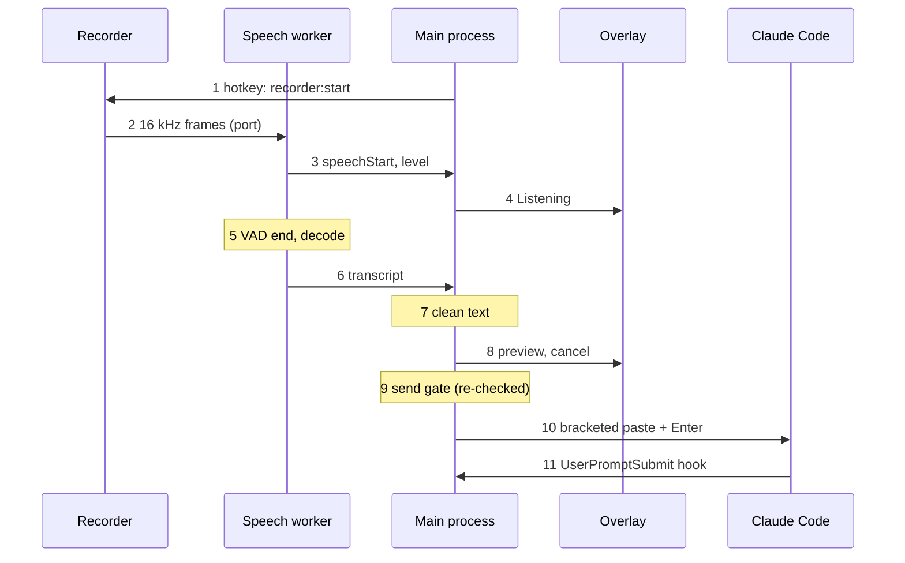

# VoiceUp — Technical Specification

Last updated: 2026-11-02 · Owner: Antonio

## 1. Overview and scope

This spec turns `docs/PLAN.md` into implementable contracts: process layout, interfaces, schemas, configs and test strategy for v1.0 (Windows desktop) and v1.2 (Android companion). When code and spec disagree, fix one of them in the same PR.

**Targets.** Windows 10 1809+ x64 (ConPTY and Claude Code minimum), English only. v1.2 adds Android (minimum version decided in S9.1) and one Linux VPS.

**Reference hardware.** Budgets are met on a low-end machine: 4-core laptop CPU, 8 GB RAM, integrated GPU. Your own PC is the fast reference.

**Conventions.** "Must" items are acceptance-critical. Rows marked "confirm only" in §11 are known answers that the named spike re-checks on Windows.

| Metric | Budget | Verified in |
| --- | --- | --- |
| Hotkey press → "Listening" overlay | ≤ 150 ms | S3.4 |
| End of speech → preview shown, 5 s command, low-end CPU | ≤ 1.5 s after the silence window | S4.1 |
| Cold start → usable terminal | ≤ 3 s | S1.1 |
| Idle CPU, app in tray, Claude idle | < 1% | S7.1 |
| Speech worker RAM, model loaded | ≤ 1.2 GB Parakeet, ≤ 600 MB Moonshine (measured on Linux, 16.7 s clip: 1.06 GB and 0.53 GB peak RSS; Windows confirmed in S4.1) | S4.1 |
| Installer size, no models | ≤ 150 MB | S6.1 |

## 2. Repository layout and module boundaries

One monorepo from day one; v1.0 only creates `desktop/` and `docs/`, the v1.2 folders arrive with E8. The `src/core`, `src/main` paths in PLAN.md live under `desktop/`.

```
voiceup/
├── CLAUDE.md                  # root rules: stack, commands, practices
├── docs/                      # PLAN.md, TECH_SPEC.md, decisions/, manual-tests.md, threat-model.md
├── .claude/skills/            # project skills (section 10)
├── desktop/
│   ├── CLAUDE.md              # desktop-specific commands and gotchas
│   ├── electron.vite.config.ts
│   ├── electron-builder.yml
│   ├── resources/             # icons, silero_vad.onnx, models.json, third-party licenses
│   ├── test/                  # fake-claude.mjs, scenarios/, audio fixtures
│   └── src/
│       ├── core/              # pure TS: state reducer, send gate, text filter, queue, settings migrate
│       ├── shared/            # zod schemas + inferred types: ipc, worker, hooks, settings
│       ├── main/              # lifecycle, windows, pty, hooks server, hotkeys, models, updater
│       ├── preload/           # one file per window, contextBridge only
│       ├── renderer/          # terminal/, overlay/, recorder/, settings/, wizard/
│       └── worker/            # speech utility process (sherpa-onnx)
├── protocol/                  # v1.2: versioned JSON Schemas shared by desktop and android
├── server/                    # v1.2: Phoenix app + deploy/ (compose, Caddyfile, relay config)
└── android/                   # v1.2: Kotlin + Compose app
```

Import rules are enforced by ESLint (`no-restricted-imports` per folder, in `desktop/eslint.import-rules.mjs`), so a violation fails CI rather than review. "May import" is an allowlist: anything not listed is rejected, even if "Must not import" does not name it. Test files may also import `vitest`. `core/`, `shared/`, `preload/` and `renderer/` also ban dynamic `import()`, which `no-restricted-imports` cannot see. `process.parentPort` is a global, so `worker/` needs no `electron` import at all:

| Folder | May import | Must not import |
| --- | --- | --- |
| `core/` | `core/`, `shared/` | `electron`, any `node:*`, `fs`, network |
| `shared/` | `zod` | everything else |
| `renderer/` | `shared/`, browser APIs, `@xterm/*` | `main/`, `worker/`, `node:*` |
| `preload/` | `electron` (`contextBridge`, `ipcRenderer`), `shared/` | `main/`, `worker/` |
| `worker/` | `core/`, `shared/`, `sherpa-onnx-node`, `node:*` | `electron` main APIs other than `process.parentPort` |
| `main/` | everything except `renderer/` | `renderer/` |

## 3. Process model and runtime topology

Seven processes at runtime; only the main process holds authority, and it is the only one that writes to the Claude PTY.

| Process | Kind | Responsibilities | Trust |
| --- | --- | --- | --- |
| Main | Electron main | windows, `globalShortcut`, PTY host, hook HTTP server, state reducer instance, send gate, queue, settings, model manager, updater | Trusted |
| Terminal window | `BrowserWindow`, sandboxed | renders PTY output with xterm, forwards keystrokes | Renders untrusted ANSI from Claude |
| Overlay window | transparent, always-on-top, `focusable: false`, click-through | listening, level, preview countdown, queue, blocked reason | Display only |
| Recorder window | hidden, sandboxed | `getUserMedia` + AudioWorklet, streams 16 kHz frames | Display-free, mic only |
| Settings / wizard window | `BrowserWindow`, sandboxed | forms, model download progress | Untrusted input, validated in main |
| Speech worker | `utilityProcess` | Silero VAD + recognizer via `sherpa-onnx-node` | Trusted code, untrusted audio |
| `claude` | child of ConPTY | the agent; spawns `curl.exe` for the `SessionStart` hook | External |

**Startup order.**

1. Single-instance lock (`app.requestSingleInstanceLock()`); a second launch focuses the first. `--smoke-test` skips the lock and step 2's settings so it can run beside an open copy.
2. Load and migrate settings; open logs.
3. Register `app://` as a privileged scheme before `ready`, serve it with `protocol.handle`, then create the terminal and hidden windows.
4. Delete hook and token files left by a crashed run. Start the hook server on `127.0.0.1:0`; generate the per-launch token and hook settings file.
5. Spawn the speech worker and send `init` (model load runs in the background; the hotkey shows "Loading speech model" until `ready`).
6. Spawn `claude` in the PTY; state = `starting` until `SessionStart` arrives.
7. Register the global hotkey; report failure if taken.

**Shutdown order** (`before-quit`): unregister shortcuts → stop recording → `kill()` the PTY and wait up to 2 s → stop the worker → close the hook server → delete the per-launch hook files → flush logs. A watchdog force-exits after 5 s so a hung child never keeps the app alive.

**One voice command, step by step:**



The main process brokers every step: audio flows recorder to worker over a direct port, but only main decides what is shown, and step 9 re-checks Claude's state right before anything is typed.

## 4. Claude Code integration

VoiceUp drives the official interactive `claude` binary through a pseudo-terminal and learns its state only from documented hooks; it never parses the screen and never touches credentials.

### 4.1 PTY host

```ts
const claude = pty.spawn(claudePath, [
  '--settings', hookSettingsPath,
  ...(settings.claude.browserControl ? ['--chrome'] : []),
], {
  name: 'xterm-256color', cols, rows, cwd: settings.claude.projectDir,
  env: { ...childEnv(process.env), VOICEUP_HOOK_TOKEN: token },
  // ConPTY is node-pty's only Windows backend; no option needed
});
```

- **Resolve `claudePath`** in this order: `where.exe claude.exe`, `%USERPROFILE%\.local\bin\claude.exe`, then `where.exe claude.cmd`. Never use a bare `where.exe claude`: on an npm install its first hit is an extensionless shell shim that can't be spawned. A `.cmd` runs as `cmd.exe /d /s /c`, and S1.1 checks Ctrl+C through it. Re-resolve after S6.3 installs Claude, checking the known install paths too, because the running app's PATH is stale. Dev and test builds also accept `VOICEUP_CLAUDE_CMD`, a JSON array such as `["node", "test/fake-claude.mjs"]`; packaged builds ignore it.
- **Output:** `onData` chunks are batched per 16 ms and sent to the terminal window. If the renderer reports more than 1 MB unacknowledged, call `pause()` until xterm's write callback drains it.
- **Input:** every keystroke from xterm goes through main (`term:input`) before `write()`. That is what makes prompt-dirty tracking possible (4.4).
- **Resize:** debounce 50 ms, clamp to 10–1000 columns, 5–500 rows.
- **Environment:** pass the user's environment unchanged, except that `childEnv` removes `CLAUDECODE` and `CLAUDE_CODE_ENTRYPOINT`. They are set only when the app itself runs under Claude Code (typically dev). S1.1 measured `claude -p` running normally with `CLAUDECODE=1` set (Claude Code 2.1.316), so a nested start is not always refused; they are still removed so the child never believes it is nested. If `ANTHROPIC_API_KEY` is set, warn (S6.4) but never strip it silently.

### 4.2 Hook configuration

Per launch, main writes `userData/run/hooks-<pid>.json` and passes it with `--settings`. User and project settings are never modified. Every hook returns an empty 200 within 5 s, so it can never block or alter Claude.

```json
{
  "hooks": {
    "SessionStart": [{ "hooks": [{ "type": "command", "command": "<SystemRoot>/System32/curl.exe",
      "args": ["-s", "-m", "2", "--noproxy", "*", "-X", "POST", "-H", "@<userData>/run/hook-header-<pid>.txt",
               "-H", "Content-Type: application/json", "--data-binary", "@-",
               "http://127.0.0.1:<port>/hooks/SessionStart"], "timeout": 5 }] }],
    "UserPromptSubmit": [{ "hooks": [{ "type": "http",
      "url": "http://127.0.0.1:<port>/hooks/UserPromptSubmit",
      "headers": { "X-VoiceUp-Token": "$VOICEUP_HOOK_TOKEN" },
      "allowedEnvVars": ["VOICEUP_HOOK_TOKEN"], "timeout": 5 }] }]
  }
}
```

The same `http` handler is registered for `PreToolUse`, `PermissionRequest`, `PostToolUse`, `PostToolUseFailure`, `Notification`, `Elicitation`, `ElicitationResult`, `Stop`, `StopFailure` and `SessionEnd`. `SessionStart` only supports command and MCP hooks, hence `curl.exe` in exec form. The token reaches curl through a header file (curl's `-H @file`), so it never appears in a process list; that file lives in the per-user %APPDATA% folder and is deleted on quit, or at the next startup after a crash. curl runs by absolute path, so PATH can't substitute it, and with `--noproxy`, so a user's proxy settings can't swallow a loopback call.

**Blocked hooks (S2.3).** At launch, main reads only these keys from the user, project, local and managed settings: `allowedHttpHookUrls` (merged across levels), `disableAllHooks` and managed `allowManagedHooksOnly`. If they stop our hooks running, show `HOOKS_BLOCKED`. After 30 s in `starting`, show the non-blocking `STARTING_SLOW` hint; a trust prompt or login can legitimately take longer, so voice just stays blocked.

### 4.3 State reducer

A pure function in `core/state`: `reduce(state, event) → { state, effects }`. Events are hook events plus `ptyExit`, `userKey(kind)`, `sessionRestart`, `localUiSuspected`, `deliveryTimeout` and `reArm`. This table is provisional until the S2.1 recordings confirm it; anything not listed moves to `unknown`, which blocks sending.

| From | Event | To |
| --- | --- | --- |
| any | `SessionStart` with source `startup`, `resume` or `clear` | `idle` |
| any | `SessionStart` with source `compact` or `fork` | unchanged: auto-compaction can fire mid-turn |
| `idle` | `UserPromptSubmit` | `busy` |
| `unknown` | `UserPromptSubmit` | `busy` |
| `busy` | `UserPromptSubmit`, `PreToolUse`, `PostToolUse`, `PostToolUseFailure` | `busy` (no change) |
| `idle` | `PreToolUse`, `PostToolUse`, `PostToolUseFailure` carrying `agent_id` (subagent or background agent) | `idle` (no change) |
| `busy`, `awaitingPermission` | `PermissionRequest`, `Notification` matcher `permission_prompt` | `awaitingPermission` |
| `awaitingPermission` | `PostToolUse`, `PostToolUseFailure`, `PreToolUse` | `busy` |
| `busy`, `awaitingPermission` | `Stop` | `idle` |
| `busy` | `StopFailure` | `idle` + error effect |
| any live state | `Elicitation`, `Notification` matcher `elicitation_dialog` or `elicitation_url_dialog` | `awaitingInput` |
| `awaitingInput` | `ElicitationResult` | `busy` |
| `idle`, `unknown` | `Stop`, `Notification` matcher `idle_prompt` | `idle` |
| any | `Notification` with an allowlisted harmless type (below) | unchanged |
| `busy`, `awaitingPermission`, `awaitingInput` | `userKey(Esc or Ctrl+C)` | `unknown` |
| `idle` | `userKey(Esc)` (double-Esc opens a menu) | `unknown` |
| any | any other `userKey` | unchanged; feeds the prompt-dirty tracker (§4.4) |
| `idle` | `localUiSuspected` (§4.4) | `unknown` |
| any | `deliveryTimeout` (§4.5) | `unknown` |
| `unknown` | `reArm` | `idle` |
| any | `SessionEnd` with reason `clear` or `resume` | unchanged: a new session follows, and its `SessionStart` decides |
| any | any other `SessionEnd`, `ptyExit` | `exited` |
| any | `sessionRestart` | `starting` |

**Allowlisted notification types:** `auth_success`, `agent_completed`, `elicitation_complete`, `elicitation_response`, `quota_auto_resume_fired`, `quota_auto_resume_stale`, `quota_auto_resume_disabled`, `plugin_notification`. Any other type not in the table, including `agent_needs_input` and future values, moves to `unknown`. `permission_prompt` only arrives after the prompt has waited about six seconds, so `PermissionRequest` is the primary signal.

**Leaving `unknown`.** The hooks reference says `Stop` does not run after a user interrupt, so an Esc must not wait for it. `unknown` ends through `idle_prompt` (about 60 s after Claude finishes, and only if the user hasn't typed and no background agent is running), a later turn (`UserPromptSubmit`, then `Stop`) or the manual "Re-arm voice" action in the status bar, where the user confirms that the main prompt is ready. It never ends on a timer.

### 4.4 Send gate and prompt-dirty tracking

`gate(state, promptDirty, deliveryPending, queueLength, settings) → send | queue | block(reason)`. While `deliveryPending` is true (text written, `UserPromptSubmit` not yet seen), `idle` is treated like `busy`, so two sends can never overlap.

| State | Prompt clean | Prompt has typed text |
| --- | --- | --- |
| `idle` | send | block: "You have unsent text" |
| `busy` | queue if enabled and not full, else block | queue (sent only once clean) |
| `awaitingPermission`, `awaitingInput` | block: "Claude is waiting for you" | block |
| `starting`, `exited`, `unknown` | block with the state name | block |

`promptDirty` is an allowlist. While `idle`, terminal input leaves it unchanged only if it is a recognized harmless sequence (focus reports, mouse reports, scrolling). Everything else sets it, including printable keys, paste, Backspace, Delete, Up/Down history recall and any unrecognized escape sequence. It resets on `UserPromptSubmit`, a `SessionStart` that returns to `idle`, Ctrl+C and session restart. Enter alone does not reset it: Enter with no `UserPromptSubmit` or `SessionStart` within about 1 s raises `localUiSuspected`, because it may have opened a local menu that no hook reports (S2.1 confirms the timing). It is deliberately pessimistic: a false "dirty" only blocks a voice send, it never loses typed text.

### 4.5 Input injection

1. Sanitize: remove C0 control characters and ESC, collapse newlines to spaces, cap at 4,000 characters.
2. Re-run the gate immediately before writing, because the state can change during the preview. Set `deliveryPending`.
3. Write `ESC[200~` + text + `ESC[201~`, then `\r` after 30 ms (method and delay confirmed by S5.3).
4. Expect `UserPromptSubmit` within 3 s, then clear `deliveryPending`. If it doesn't arrive, clear it, raise `deliveryTimeout` and show `DELIVERY_UNCONFIRMED`.

**Preview controls.** The overlay is click-through and never takes focus, so it has no buttons. During a preview, Esc (a global shortcut held only while recording, previewing or holding a blocked transcript) cancels and the hotkey sends at once, except in the first 300 ms of the preview, when it is ignored so a late cancel press can't send. While transcribing, the hotkey cancels. In always-confirm mode the preview waits for one of those two keys; a global Enter shortcut is never registered, because it would steal Enter from every other app.

**Blocked transcripts.** When the gate blocks, the last transcript stays in memory for up to 30 s and is never written to disk. The overlay shows the reason; the hotkey retries through the gate and Esc discards it.

## 5. Speech pipeline

One hotkey press produces exactly one recording, one VAD segment and one transcript, tagged with a `recordingId` so late results from a cancelled recording are dropped.

### 5.1 Capture (recorder window)

- `getUserMedia({ audio: { deviceId, channelCount: 1, echoCancellation: false, noiseSuppression: true, autoGainControl: true } })`. The mic opens only while recording, so the Windows mic indicator is honest.
- `new AudioContext({ sampleRate: 16000 })` lets Chromium resample; an AudioWorklet emits `Float32Array` frames of 512 samples (32 ms, Silero's window at 16 kHz).
- Frames go to the worker over a `MessagePort` as transferables. Main wires the port once: `MessageChannelMain` → `port1` to the recorder (`webContents.postMessage`), `port2` to the worker (`utilityProcess.postMessage`).
- The overlay shows "Listening" only after the first frame arrives, so the 150 ms budget is measured against real audio, not intent.

### 5.2 Voice activity detection (worker)

Verified 2026-10-26 against `sherpa-onnx-node` 2.0.0 (its `types.js`) and a real run on Electron 45.0.0 inside a `utilityProcess`. Pin `sherpa-onnx-node` to an exact version; 2.0.0 is a new major.

```ts
const vad = new sherpa.Vad({
  sileroVad: {
    model: sileroPath, threshold: 0.5, windowSize: 512,
    minSilenceDuration: s.endSilenceSec,   // 1.2 default
    minSpeechDuration: s.minSpeechSec,     // 0.25 default
    maxSpeechDuration: s.maxRecordingSec,  // 60 default
  },
  sampleRate: 16000, numThreads: 1, provider: 'cpu', debug: false,
}, s.maxRecordingSec + 10 /* buffer seconds, must exceed the longest recording */);

vad.acceptWaveform(frame);
if (vad.isDetected() && !started) emit({ type: 'speechStart', recordingId });
while (!vad.isEmpty()) {
  const seg = vad.front(false);   // false = copy; Electron forbids external buffers
  vad.pop();
  finish(seg.samples);            // first segment ends this recording
}
```

A "no speech" timer (default 8 s) cancels a recording that never starts; the frame loop also enforces the max length.

### 5.3 Recognition (worker)

```ts
const rec = new sherpa.OfflineRecognizer({
  featConfig: { sampleRate: 16000, featureDim: 80 },
  modelConfig: {
    transducer: { encoder, decoder, joiner }, tokens,
    modelType: 'nemo_transducer',
    numThreads: Math.max(1, Math.min(4, os.availableParallelism() - 1)),
    provider: 'cpu', debug: false,
  },
  decodingMethod: 'greedy_search',
});
const stream = rec.createStream();
stream.acceptWaveform({ sampleRate: 16000, samples });
const { text } = await rec.decodeAsync(stream);   // non-blocking; same text as decode()
```

Moonshine base:

```ts
modelConfig: {
  moonshine: { preprocessor: 'preprocess.onnx', encoder: 'encode.int8.onnx',
               uncachedDecoder: 'uncached_decode.int8.onnx', cachedDecoder: 'cached_decode.int8.onnx' },
  tokens: 'tokens.txt', numThreads, provider: 'cpu', debug: false,
}
```

- Load the recognizer with `await sherpa.OfflineRecognizer.createAsync(config)` so the worker stays responsive to `cancel` while the 650 MB Parakeet encoder loads.
- `decodeAsync` keeps the worker's event loop free, but the worker still lives in a `utilityProcess` (native crash isolation, memory). Main keeps a timeout of max(10 s, half the clip length) that kills and restarts a stuck worker; a flat 10 s could kill a legitimate 60 s Parakeet decode at the measured 1-thread speed (RTF 0.17).
- External buffers: in Electron, `vad.front()` and `readWave(path)` with the default argument throw `External buffers are not allowed`; `front(false)` and `readWave(path, false)` work. Plain Node accepts both, so only an Electron test catches it.
- Spike timings (2 vCPU Linux container, 5.9 s clip, `numThreads: 4`): Parakeet load 2.2 s, decode 1.8 s; Moonshine base load 1.3 s, decode 0.6–0.8 s. Both transcribed the clip correctly. Real numbers come from the S4.1 benchmark on the reference laptops.

### 5.4 Model manager (main)

Models are listed in a bundled `resources/models.json`, pinned per app version:

```json
[
  {
    "id": "parakeet-tdt-0.6b-v2-int8",
    "type": "nemo_transducer",
    "url": "https://github.com/k2-fsa/sherpa-onnx/releases/download/asr-models/sherpa-onnx-nemo-parakeet-tdt-0.6b-v2-int8.tar.bz2",
    "sha256": "157c157bc51155e03e37d2466522a3a737dd9c72bb25f36eb18912964161e1ad",
    "bytes": 482468385,
    "dir": "sherpa-onnx-nemo-parakeet-tdt-0.6b-v2-int8",
    "files": { "encoder": "encoder.int8.onnx", "decoder": "decoder.int8.onnx", "joiner": "joiner.int8.onnx", "tokens": "tokens.txt" }
  },
  {
    "id": "moonshine-base-en",
    "type": "moonshine",
    "url": "https://github.com/k2-fsa/sherpa-onnx/releases/download/asr-models/sherpa-onnx-moonshine-base-en-int8.tar.bz2",
    "sha256": "21870cecaa2e44e4e2bf63e02d1072bed183ccd10284871353bd9d24dad14e5e",
    "bytes": 250807309,
    "dir": "sherpa-onnx-moonshine-base-en-int8",
    "files": { "preprocessor": "preprocess.onnx", "encoder": "encode.int8.onnx", "uncachedDecoder": "uncached_decode.int8.onnx", "cachedDecoder": "cached_decode.int8.onnx", "tokens": "tokens.txt" }
  }
]
```

Values measured 2026-10-26 from the downloaded archives. Unpacked: Parakeet about 661 MB (encoder 652 MB), Moonshine about 287 MB. Each archive extracts into the `dir` folder and also contains `test_wavs/`, which the extractor skips.

- Download to `userData/models/<id>.partial` with HTTP `Range` resume; hash while streaming; on mismatch delete and report `MODEL_CORRUPT`.
- Extract to `userData/models/<id>.tmp`, then rename atomically to `userData/models/<id>`. The `.tar.bz2` extractor library is chosen in S4.3.
- On startup, check presence and size of each file only; the full hash runs once, at download.
- `silero_vad.onnx` (643,854 bytes, sha256 `9e2449e1087496d8d4caba907f23e0bd3f78d91fa552479bb9c23ac09cbb1fd6`, from the same `asr-models` release) ships in `resources/` and is never downloaded.

### 5.5 Text cleaning (core)

A pure `clean(text, minWords) → string | null`: trim and collapse whitespace; strip control characters; remove bracketed tags (`[BLANK_AUDIO]`, `(music)`); collapse any token repeated 4 or more times in a row; return `null` below `minWords` (default 1). Fixture-tested.

## 6. Interfaces

Every boundary has one zod schema in `shared/`, imported by both sides; nothing crosses a process boundary unparsed.

### 6.1 IPC channels

| Channel | Direction | Payload | Windows |
| --- | --- | --- | --- |
| `term:data` | main → renderer | string, batched per 16 ms | terminal |
| `term:input` | renderer → main | string, ≤ 64 KB | terminal |
| `term:resize` | renderer → main | `{ cols, rows }`, clamped | terminal |
| `term:ack` | renderer → main | bytes written (flow control) | terminal |
| `state:changed` | main → renderer | `{ state, reason?, queue: [{ id, preview }] }` | terminal, overlay, settings |
| `overlay:show` | main → renderer | union on `phase`: `listening{level}`, `transcribing`, `preview{text, countdownMs}`, `blocked{reason}`, `error{code, message}`, `hidden` | overlay |
| `recorder:start` / `recorder:stop` | main → renderer | `{ recordingId, deviceId }` / `{ recordingId }` | recorder |
| `recorder:error` | renderer → main | `{ recordingId, code }` | recorder |
| `settings:get` / `settings:set` | invoke | → `Settings` / `Partial<Settings>` → `Result` | settings, wizard |
| `models:status` / `models:download` | invoke + `models:progress` events | `{ id }` → status | settings, wizard |
| `devices:list` | invoke | → `[{ deviceId, label }]` (the recorder enumerates) | settings |
| `app:openLogs` | invoke | none | settings |
| `state:rearm` | renderer → main | `{}`; ignored unless the state is `unknown` | terminal |

Rules for every handler: `validateSender(event)` checks that the sending frame's origin is `app://` and that the window id is in the channel's allowlist; then `schema.parse`. A failed check logs at `warn` and drops the message. Each preload exposes only its own window's channels as named functions, never `ipcRenderer` itself. Payloads are objects, except the high-frequency `term:*` stream channels, which may carry a bare string or number. Main clamps `term:resize` values rather than rejecting them.

### 6.2 Worker messages

| Message | Direction | Payload |
| --- | --- | --- |
| `init` | main → worker | `{ modelId, modelPaths, sileroPath, vad: {...}, numThreads }` |
| `start` / `stop` / `cancel` | main → worker | `{ recordingId }` |
| `ready` | worker → main | `{ modelId, loadMs }` |
| `speechStart` | worker → main | `{ recordingId }` |
| `level` | worker → main | `{ recordingId, rms }`, at most 20 per second |
| `speechEnd` | worker → main | `{ recordingId, durationMs }` |
| `transcript` | worker → main | `{ recordingId, text, decodeMs }` |
| `error` | worker → main | `{ recordingId?, code, message }` |

### 6.3 Hook HTTP API

`POST /hooks/{EventName}` on `127.0.0.1:<random port>`, header `X-VoiceUp-Token`, body = Claude Code's hook JSON (limit 1 MB).

- Token compared with `crypto.timingSafeEqual`; mismatch → 401 and a `warn` log.
- After a valid token, **always 200 with an empty body**, even for an unparseable body or an unknown event. A non-2xx would show a hook-error notice inside Claude Code; the problem is logged on our side instead.
- Parsed fields: `hook_event_name`, `session_id`, optional `agent_id`, `source` on `SessionStart`, `reason` on `SessionEnd`, plus `notification_type` (string), `message` (string) and optional `title` on `Notification`, per `NotificationHookInput` in the Agent SDK types. Treat `notification_type` as an open string, not an enum: values outside §4.3 and its allowlist move the state to `unknown`; other fields pass through untyped and are logged at `debug` only, because they can contain prompts and tool input.

### 6.4 Settings schema

```ts
export const Settings = z.object({
  version: z.literal(1),
  hotkey: z.string().default('Control+Shift+Space'),  // Ctrl+Alt = AltGr on HR layouts
  micDeviceId: z.string().nullable().default(null),
  speech: z.object({
    modelId: z.enum(['auto', 'parakeet-tdt-0.6b-v2-int8', 'moonshine-base-en']).default('auto'),  // auto: >= 15 GiB reported RAM -> Parakeet, else Moonshine
    endSilenceSec: z.number().min(0.5).max(3).default(1.2),
    minSpeechSec: z.number().min(0.1).max(1).default(0.25),
    maxRecordingSec: z.number().min(5).max(120).default(60),
    noSpeechTimeoutSec: z.number().min(3).max(30).default(8),
    minWords: z.number().int().min(1).max(5).default(1),
  }).prefault({}),
  delivery: z.object({
    previewMs: z.number().int().min(0).max(5000).default(1000),
    alwaysConfirm: z.boolean().default(false),
    queue: z.boolean().default(true),
    maxQueue: z.number().int().min(1).max(5).default(3),
  }).prefault({}),
  claude: z.object({
    projectDir: z.string().nullable().default(null),
    browserControl: z.boolean().default(false),
  }).prefault({}),
  ui: z.object({
    fontSize: z.number().int().min(8).max(32).default(14),
    sounds: z.boolean().default(true),
    startWithWindows: z.boolean().default(false),
  }).prefault({}),
  logLevel: z.enum(['error', 'warn', 'info', 'debug']).default('info'),
});
```

`migrate(raw)` upgrades by `version`, strips unknown keys and fills defaults. `.prefault({})` makes zod 4 parse a missing section as `{}`, so its field defaults apply. An unreadable file is renamed to `settings.bad-<timestamp>.json` and replaced with defaults; a file counts as unreadable if it is not valid JSON, has no upgrade path for its `version`, or holds any invalid value. If it cannot be renamed, it is kept and defaults apply for that run only. The app never fails to start over settings. Writes go to a temp file and are renamed atomically.

### 6.5 Error codes

| Code | Trigger | User sees | Recovery |
| --- | --- | --- | --- |
| `MIC_DENIED` | `NotAllowedError` | "Windows is blocking the microphone" | button opens `ms-settings:privacy-microphone` |
| `MIC_MISSING` | `NotFoundError`, device unplugged | "No microphone found" | device picker |
| `HOTKEY_TAKEN` | `register()` returns false | "Another app uses this hotkey" | hotkey setting |
| `MODEL_MISSING`, `MODEL_CORRUPT` | file absent, hash mismatch | "Speech model needs downloading" | download button |
| `WORKER_CRASHED` | worker exit ≠ 0 three times in 60 s | "Speech engine stopped" | restart button, logs link |
| `APP_START_FAILED` | a package fails to load, or an uncaught exception in main | "VoiceUp could not start" and the error | reinstall; the app exits 1 and never lingers without a window |
| `CLAUDE_NOT_FOUND` | no binary | install screen (S1.5 / S6.3) | install |
| `CLAUDE_EXITED` | PTY exit | exit code + "Restart session" | restart |
| `HOOKS_BLOCKED` | `allowedHttpHookUrls` excludes us, `disableAllHooks` or `allowManagedHooksOnly` applies | "Your Claude settings block VoiceUp's status hooks" | docs link; voice disabled |
| `STARTING_SLOW` | 30 s in `starting` | "Waiting for Claude to start" | finish any prompt in the terminal, otherwise check the hooks |
| `CLAUDE_TOO_OLD` | `claude --version` below the minimum constant | "Claude Code needs updating" | shows the update command |
| `CLAUDE_NOT_LOGGED_IN` | sign-in step incomplete, or `StopFailure` with an authentication error | "Claude isn't signed in" | sign in inside the terminal |
| `API_KEY_SET` | `ANTHROPIC_API_KEY` in the environment | "An API key overrides your subscription and bills the API" | explains how to remove it; continue allowed |
| `CHROME_NOT_DETECTED` | Claude reports the extension is missing | "Claude can't reach your browser" | restart the browser and Claude, or `/chrome` → Reconnect |
| `NO_SPEECH` | "no speech" timer expires | "Didn't hear anything" | press the hotkey again; check the mic |
| `TRANSCRIPT_DROPPED` | cleaner returns `null` | "Nothing usable was heard" | press the hotkey again |
| `TRANSCRIBE_TIMEOUT` | decode exceeds the timeout (§5.3) | "Transcription took too long" | worker restarts; try again |
| `GATE_BLOCKED` | gate returns block | the reason text | none needed |
| `DELIVERY_UNCONFIRMED` | no `UserPromptSubmit` in 3 s | "Command may not have been sent" | check terminal |

User-facing text lives in one `messages.ts` table keyed by code; logs always carry the code.

## 7. Build, packaging, release and CI

Every merge to `main` produces a packaged, smoke-tested `.exe`; a tag publishes it with checksums.

### 7.1 Build

- `electron-vite` with three targets: main (entries `index` and `speechWorker`), preload (one entry per window), renderer (one HTML entry per window).
- `node-pty` and `sherpa-onnx-node` are externals, never bundled.
- Renderers load from a custom `app://` protocol served by `protocol.handle` from the packaged renderer folder, never `file://` (Electron security item 18). The scheme is registered with `protocol.registerSchemesAsPrivileged` as `standard`, `secure` and `supportFetchAPI` before `ready`, because `getUserMedia` and AudioWorklet need a secure context. Media permission is granted by `setPermissionRequestHandler` and `setPermissionCheckHandler` only to the recorder window.
- **Dev mode.** `npm run dev` serves renderers from the electron-vite dev server. Only when `!app.isPackaged`, windows may load that exact `ELECTRON_RENDERER_URL` origin and `validateSender` accepts it. The CSP needs no dev exception: pages come from that origin, and `connect-src 'self'` covers its same-origin HMR WebSocket (measured in S0.1). Packaged builds accept `app://` only, and a test proves it.

### 7.2 Packaging (`electron-builder.yml`)

```yaml
appId: app.voiceup.desktop
productName: VoiceUp
asar: true
files:                     # only what ships; the default would also pack src/ and tests
  - out/**/*
  - resources/**/*
  - package.json
  - '!**/node_modules/node-pty/prebuilds/{darwin,linux}-*/**'   # S0.6: 7.0 MB -> 2.9 MB unpacked
  - '!**/node_modules/node-pty/prebuilds/win32-arm64/**'
  - '!**/node_modules/node-pty/{deps,src,third_party,scripts,typings}/**'
  - '!**/node_modules/node-pty/binding.gyp'
  - '!**/*.pdb'
npmRebuild: false            # S0.6: the default fails without Visual Studio; prebuilds need no rebuild
asarUnpack:
  - "**/node_modules/node-pty/**"
  - "**/node_modules/sherpa-onnx-*/**"
  - "resources/**"
win:
  target: [nsis]
nsis:
  oneClick: false
  perMachine: false
  allowToChangeInstallationDirectory: true
electronFuses:              # native since electron-builder 26 (verified in 26.18.0); applied after afterPack, before signing
  runAsNode: false
  enableNodeOptionsEnvironmentVariable: false
  enableNodeCliInspectArguments: false
  enableEmbeddedAsarIntegrityValidation: true
  onlyLoadAppFromAsar: true
publish:
  provider: github
  owner: AntonioPreprotnik
  repo: VoiceUp
```

- Fuses: `electronFuses` is a top-level electron-builder option (type `FuseOptionsV1`, backed by its own `@electron/fuses` dependency) and is flipped before code signing, so the signature covers the fused binary. Do not also flip fuses in `afterPack`. `runAsNode: false` breaks `child_process.fork` and anything using `ELECTRON_RUN_AS_NODE`; VoiceUp uses `utilityProcess`, which is unaffected. `node-pty`'s `kill()` does call `child_process.fork`, which then throws and leaves one unhandled rejection per `kill()`. The native kill still runs, and S0.6 measured no crash and no surviving console grandchild; S1.1 handles the log noise. CI verifies them with `scripts/check-fuses.mjs`, which reads the packaged exe back and fails if any differs. Run it locally on the same path, or read them with `npx @electron/fuses read --app dist/win-unpacked/VoiceUp.exe`.
- Native modules: `node-pty` 1.2.0-beta.18 loads from its bundled prebuilds with no rebuild, so neither dev machines nor CI need Visual Studio or Python to install or package (S0.6, measured on a machine with no Visual Studio). `npmRebuild: false` is required: electron-builder's default tries to compile and fails without Visual Studio. A compile from source works on `windows-latest` if ever needed. `sherpa-onnx-node` ships N-API prebuilds and needs no rebuild. Unused platforms' prebuilds and build sources are excluded to protect the installer budget.
- A `--smoke-test=<file>` flag makes the packaged app load `node-pty` (spawn `cmd.exe /c exit 0`) and `sherpa-onnx-node` (create a VAD from the bundled Silero model), write a JSON result to `<file>` and exit 0 on success or 1 on failure. It also loads the terminal page in a hidden window over `app://` and fails on a load error or a console error, which is what catches asar and protocol mistakes. Until speech arrives, the result is `{"app":"ok","renderer":"ok","pty":"ok"}`. Stdout from a Windows GUI exe isn't reliable, and PowerShell doesn't wait for one, so run it with `Start-Process -Wait -PassThru`, as `scripts/smoke-test.ps1` does (confirmed in S0.6). CI runs it on every packaged build, which catches asar-unpack and ABI mistakes that unit tests in plain Node never see.

### 7.3 CI (GitHub Actions, `windows-latest`)

| Job | Runs on | Steps |
| --- | --- | --- |
| `check` | every push and PR | `npm ci`, typecheck, lint, test, `npm audit --omit=dev --audit-level=high`, license check |
| `package` | push to `main`, tags, manual dispatch | build, `electron-builder --win --publish never`, read fuses back, `--smoke-test`, upload `.exe` |
| `release` | tags `v*` | package, write `SHA256SUMS.txt`, create the GitHub Release (draft until you publish it) |

The license check covers the production dependency tree, which is what ships. The dev tree contains licenses outside the allowlist (for example BlueOak-1.0.0 and CC-BY) that never reach users.

Versioning is semver; commit messages follow Conventional Commits with the story ID as scope (`feat(S2.3): …`), so the changelog generates itself.

## 8. Testing strategy

The safety-critical logic (reducer, gate, cleaner) is pure and gets near-complete branch coverage; everything touching hardware is covered by a fake, a packaged smoke test or the manual checklist.

| Layer | Tool | Covers | Location |
| --- | --- | --- | --- |
| Unit | Vitest | reducer, gate, prompt-dirty tracker, text cleaner, queue, settings migrate | `desktop/src/core/**/*.test.ts` |
| Contract | Vitest + zod | IPC, worker and hook schemas accept every recorded fixture from S2.1 | `desktop/src/shared/**/*.test.ts` |
| Integration | Vitest, Node environment | hook server + reducer driven by the fake Claude; model manager against a local HTTP server (resume, corrupt hash, 404) | `desktop/test/integration/` |
| Speech regression | script, not CI-blocking | 20 recorded WAV commands → word error rate and decode time per model | script in `desktop/test/audio/`; recordings come from a folder path and stay out of this public repo unless the speaker agrees |
| Packaged smoke | CI | `--smoke-test` on the built `.exe` | CI `package` job |
| End to end | Playwright `_electron` (from S5.4), on the unpackaged build because the packaged fuses disable inspect flags | app launches with the fake Claude; injected WAV → text appears in the terminal | `desktop/test/e2e/` |
| Manual | checklist | real mic, hotkey over a fullscreen game, installer on a clean Windows VM | `docs/manual-tests.md` |

**Fake Claude** (`test/fake-claude.mjs`). Spawned through `VOICEUP_CLAUDE_CMD`; it reads the `--settings` file it receives, prints a prompt, echoes stdin, and POSTs the hook events of a scenario file (`test/scenarios/*.json`, recorded in S2.1) to the URLs and headers from that file. Scenarios: plain answer, auto-approved tool, permission approved, permission denied, Esc interrupt, crash mid-turn, `/clear`, `/compact`, `/resume`, MCP elicitation, subagent, background agent, local menu. Fixtures are public, so bodies are stripped of prompts, file contents, `cwd` and `transcript_path`.

**Debug logs.** Debug logs can contain transcripts and hook bodies, so they must not reach public GitHub issues: the bug-report template warns about this and accepts default-level logs only (S7.5).

**Rules.** A bug fix starts with a failing test. Tests never need a real Claude account, a microphone or the network. Snapshot tests are not used for terminal output.

## 9. v1.2 remote companion

The server only routes signed signaling between paired devices and hands out short-lived relay credentials; all content flows end to end over WebRTC, and both apps verify each other's keys so the server never has to be trusted.

### 9.1 Data-channel protocol (`protocol/`)

One reliable, ordered data channel named `voiceup`. JSON control messages carry an envelope `{ v: 1, type, id, ts }`; audio travels as binary chunks between two control messages.

| Type | Direction | Payload |
| --- | --- | --- |
| `voiceClip.begin` | phone → PC | `{ clipId, sampleRate: 16000, format: 'pcm_s16le', bytes }`, `bytes` ≤ 1,920,000 (60 s) |
| binary chunks | phone → PC | ≤ 16 KB each, in order |
| `voiceClip.end` | phone → PC | `{ clipId, sha256 }` |
| `cancel` | phone → PC | `{ clipId }` |
| `state` | PC → phone | `{ state, queueLength }` |
| `transcriptPreview` | PC → phone | `{ clipId, text, countdownMs }` |
| `result` | PC → phone | `{ clipId, outcome: 'sent' \| 'queued' \| 'blocked' \| 'cancelled', reason? }` |
| `error` | PC → phone | `{ clipId?, code }` |

Any other type, a bad envelope or a size over the limit closes the connection. The PC has no handler for anything that could move the mouse or type. A voice clip still becomes a Claude command after the send gate, so the threat model (S9.1) treats a stolen paired phone as remote command execution limited by Claude's permission mode.

### 9.2 Signaling (Phoenix 1.8)

- Socket connect params: `{ device_id, ts, sig }` where `sig` signs `"voiceup-auth|" + device_id + "|" + ts` with the device key; `ts` within ±60 s and each `(device_id, ts)` accepted once.
- Each device joins topic `device:<device_id>`. Events: `session:request`, `sdp:offer`, `sdp:answer`, `ice`, `turn:credentials`, `pair:confirm`.
- The server forwards an event only when the sender and target are a registered pair. A pair is registered when both devices have sent `pair:confirm` naming each other. Messages are never stored.

### 9.3 Pairing

1. PC shows a QR code: `voiceup://pair?s=<server>&pc=<pcDeviceId>&pk=<pcPublicKey, base64url>&n=<128-bit nonce>&exp=<unix>`, valid 2 minutes.
2. Phone connects, sends its public key to the PC through the server.
3. Both compute the confirmation code: SHA-256(pcPublicKey ‖ phonePublicKey ‖ nonce), first 4 bytes as an integer mod 10⁶, shown as 6 digits.
4. The user confirms the match on both screens; each side stores the other's public key and sends `pair:confirm`.

### 9.4 Session authentication

Each side sends, with its SDP, `sig = sign(deviceKey, SHA-256(dtlsFingerprint ‖ sessionId ‖ ts))`. The receiver checks the signature against the stored peer key, checks that the signed fingerprint matches the `a=fingerprint` line in the SDP, and after connecting checks the remote certificate fingerprint in `RTCPeerConnection.getStats()` (`remoteCertificateId`). Any mismatch aborts and warns on the PC.

### 9.5 Relay credentials

Short-lived TURN credentials per the TURN REST API scheme, supported by both coturn and eturnal: `username = <expiryUnix>:<deviceId>`, `credential = base64(HMAC-SHA1(sharedSecret, username))`, TTL 600 s, issued over `turn:credentials` only to authenticated devices.

### 9.6 Android structure

- Gradle modules: `app` (Compose UI), `protocol` (kotlinx.serialization models, tested against `protocol/` schema fixtures), `rtc` (WebRTC session, `io.getstream:stream-webrtc-android`), `pairing` (CameraX + ML Kit, Keystore keys), `audio` (`AudioRecord`, `VOICE_RECOGNITION` source, 16 kHz mono PCM16).
- Keys: EC P-256 in Android Keystore is the safe default across versions; Ed25519 only if the minimum Android version supports it in Keystore (S9.1).
- Lifecycle: the stream stops on `ON_STOP`; a foreground service of type microphone runs only while recording.

## 10. Claude Code skills for this repo

Eleven project skills in `.claude/skills/<name>/SKILL.md` encode the recipes Claude Code would otherwise relearn every session; workflow skills with side effects run only when you type them, the rest load themselves when Claude touches the matching files.

| Skill | How it runs | What it gives Claude |
| --- | --- | --- |
| `story` | `/story S2.3` only | Run one PLAN.md story end to end: branch, plan, implement, Definition of Done, commit format |
| `decision-note` | `/decision-note S4.1` only | Template and rules for spike findings in `docs/decisions/` |
| `release` | `/release 1.0.0` only | Version bump, changelog, package, smoke test, checksums, manual checklist |
| `electron-security` | auto on `desktop/src/main/**`, `preload/**`, `renderer/**` | The window, IPC, protocol and fuse checklist |
| `ipc-channel` | auto when adding IPC | Recipe: schema in `shared/`, sender-validated handler, preload function, tests |
| `claude-hooks` | auto on hooks and state files | Hook config generation, receiver rules, reducer changes, scenario fixtures |
| `native-modules` | auto on `node-pty`, `sherpa-onnx`, packaging | Rebuild, asar unpack, external buffers, smoke test |
| `speech-pipeline` | auto on `worker/**`, `renderer/recorder/**` | Frame format, VAD and recognizer config, models manifest, benchmark script |
| `remote-protocol` (v1.2) | auto on `protocol/**` | Envelope rules, adding a message type on both sides, crypto steps |
| `phoenix-signaling` (v1.2) | auto on `server/**` | Channel conventions, signed connect, ExUnit tests, deploy |
| `android-app` (v1.2) | auto on `android/**` | Module layout, permissions, Keystore, WebRTC library rules |

**How to use them.** Commit the folder with the repo; Claude Code picks up project skills automatically. Auto skills use the `paths` field, so they only load when Claude works in matching files, which keeps context small. `story`, `decision-note` and `release` set `disable-model-invocation: true` because they create branches, commits or releases. Keep each `SKILL.md` short and move long reference material into sibling files.

## 11. Open technical questions

Each question has an owner story; code that depends on the answer waits for it. What was pre-verified, and what each spike still has to confirm on Windows, is listed in `docs/decisions/README.md`.

| Question | Answered by |
| --- | --- |
| ~~Does `Stop` fire after an Esc interrupt?~~ Answered by the docs: no. S2.1 still records it once. | S2.1 (confirm only) |
| Which events follow a denied permission? | S2.1 |
| Which events fire for local UI (`/model`, `/resume`, double-Esc, login and first-run screens), and what does typed or pasted text do there? | S2.1 |
| Does `SessionEnd` come before `SessionStart` on `/clear`? | S2.1 |
| ~~Notification type field~~ Answered: `notification_type` (string), plus `message`, `title?`. | done |
| ~~Hooks before workspace trust~~ Answered by the docs: in an interactive session the trust dialog appears before the session starts, so no hook (SessionStart included) fires until it is accepted; state stays `starting`. S2.1 still records it once with a fresh folder, and confirms our `--settings` hooks then fire normally. | S2.1 (confirm only) |
| Does bracketed paste followed by `\r` submit reliably in Claude Code's prompt under ConPTY, and what delay is needed? | S5.3 |
| ~~sherpa-onnx config names, model files, SHA-256~~ Answered (§5.2–5.4). Remaining: confirm the same on the Windows prebuild in the packaged smoke test. | S4.1 (confirm only) |
| Parakeet RAM and decode time on an 8 GB, 4-core laptop; is 15 GiB of reported RAM the right threshold for the auto-pick? | S4.1 |
| Does `globalShortcut` fire while a fullscreen exclusive game has focus? | S3.1, manual test |
| ~~electron-builder `electronFuses`~~ Answered: supported natively (§7.2). | done |
| Which library extracts `.tar.bz2` model archives cleanly on Windows? | S4.3 |
| Ed25519 or P-256 for device keys, given the minimum Android version | S9.1 |

## Sources

- [Claude Code hooks reference](https://code.claude.com/docs/en/hooks): events, `http` hooks, `allowedEnvVars`, `SessionStart` limited to command and MCP hooks.
- [Claude Code skills](https://code.claude.com/docs/en/skills): `.claude/skills/`, frontmatter fields, `paths`, `disable-model-invocation`.
- [Claude Code headless docs](https://code.claude.com/docs/en/headless.md): `--settings <file-or-json>`.
- [Electron security checklist](https://www.electronjs.org/docs/latest/tutorial/security).
- [Electron desktopCapturer](https://electronjs.org/docs/api/desktop-capturer).
- [sherpa-onnx Node addon examples](https://github.com/k2-fsa/sherpa-onnx/blob/master/nodejs-addon-examples/README.md) and [FAQ on external buffers](https://k2-fsa.github.io/sherpa/onnx/faqs/index.html).
- [node-pty releases](https://github.com/microsoft/node-pty/releases).
- [Claude Code permissions: what runs before you trust a folder](https://code.claude.com/docs/en/permissions#what-runs-before-you-trust-a-folder) and [security: workspace trust](https://code.claude.com/docs/en/security).
- [@anthropic-ai/claude-agent-sdk on npm](https://www.npmjs.com/package/@anthropic-ai/claude-agent-sdk): `NotificationHookInput` in `sdk.d.ts`.
- [sherpa-onnx-node on npm](https://www.npmjs.com/package/sherpa-onnx-node) (2.0.0 `types.js`, `vad.js`, `non-streaming-asr.js`) and the [asr-models release](https://github.com/k2-fsa/sherpa-onnx/releases/tag/asr-models).
- [app-builder-lib on npm](https://www.npmjs.com/package/app-builder-lib) (26.18.0 `configuration.d.ts`, `platformPackager.js`) and [@electron/fuses](https://github.com/electron/fuses).
- [WebRTC Android by Stream](https://github.com/GetStream/webrtc-android).
- [TURN REST API draft](https://datatracker.ietf.org/doc/html/draft-uberti-behave-turn-rest-00): short-lived credential format.
